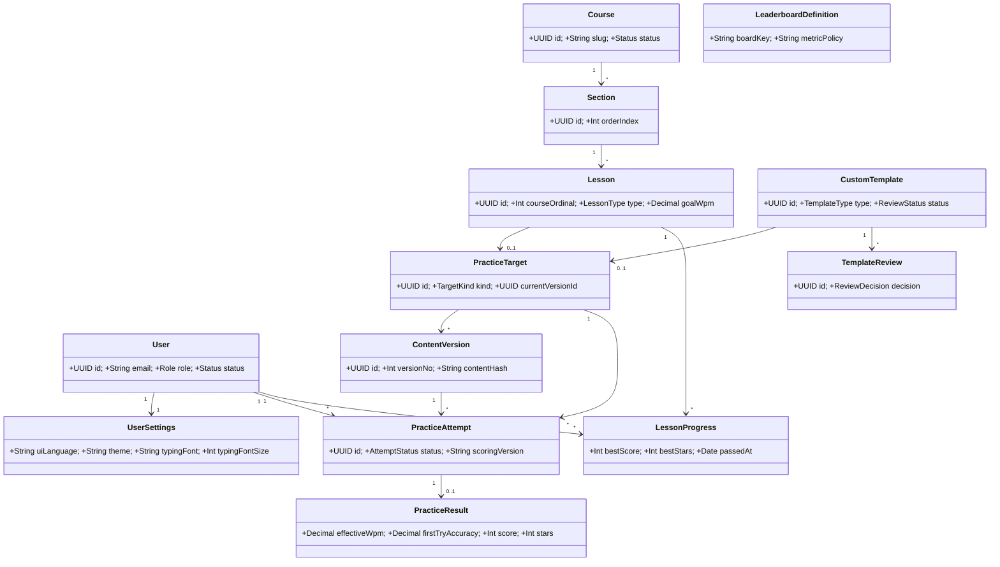
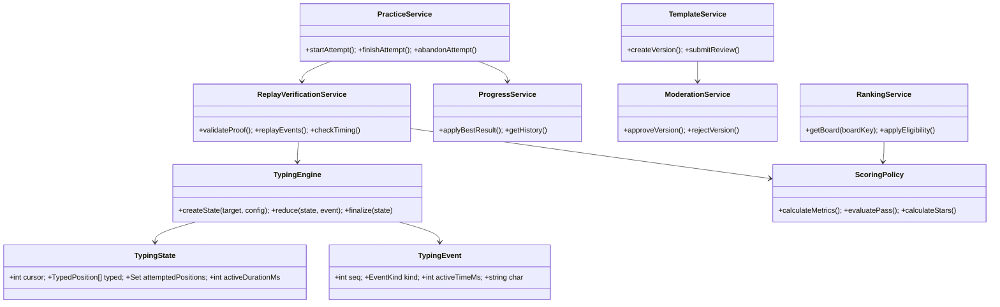
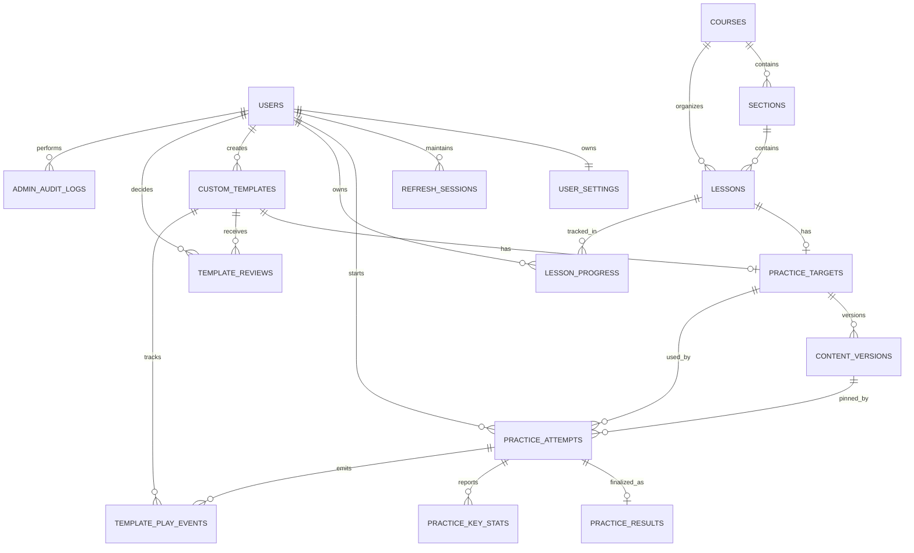
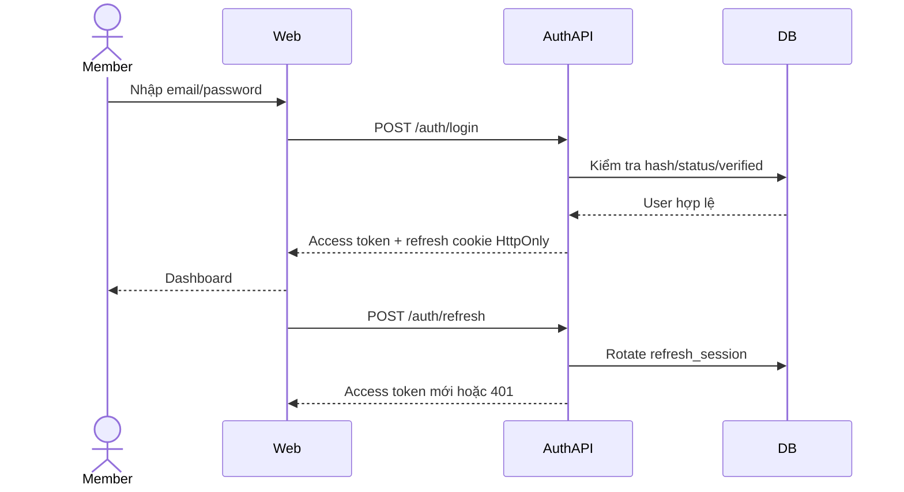
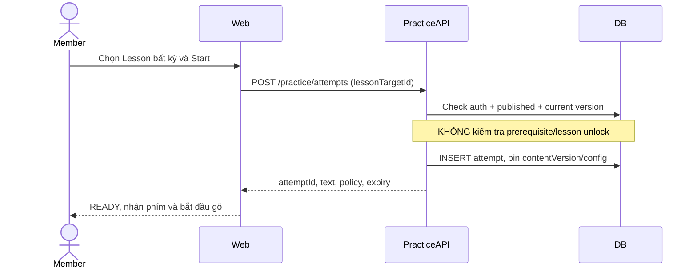
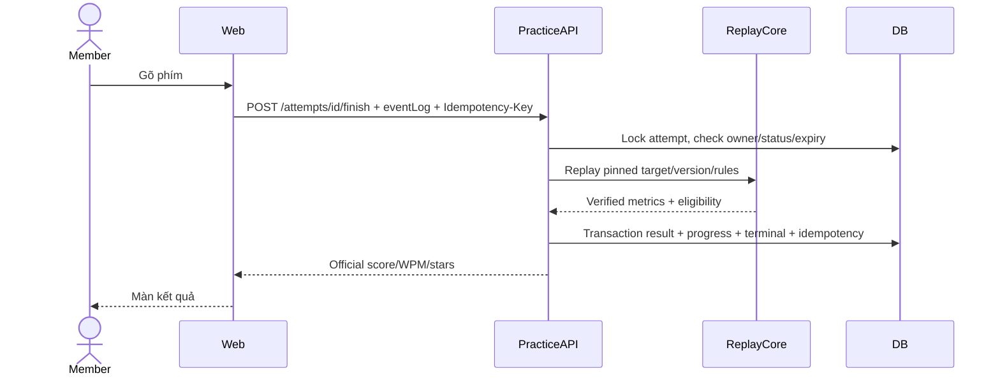
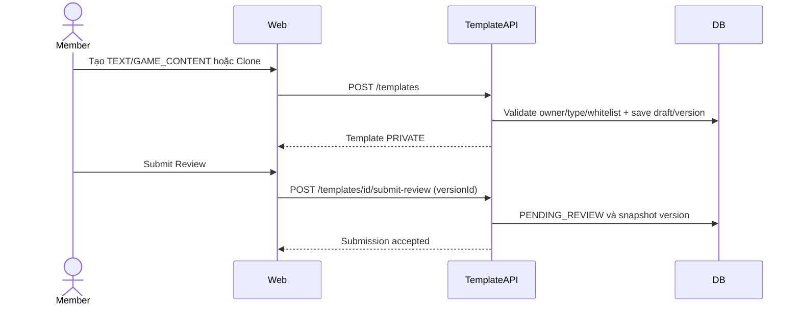
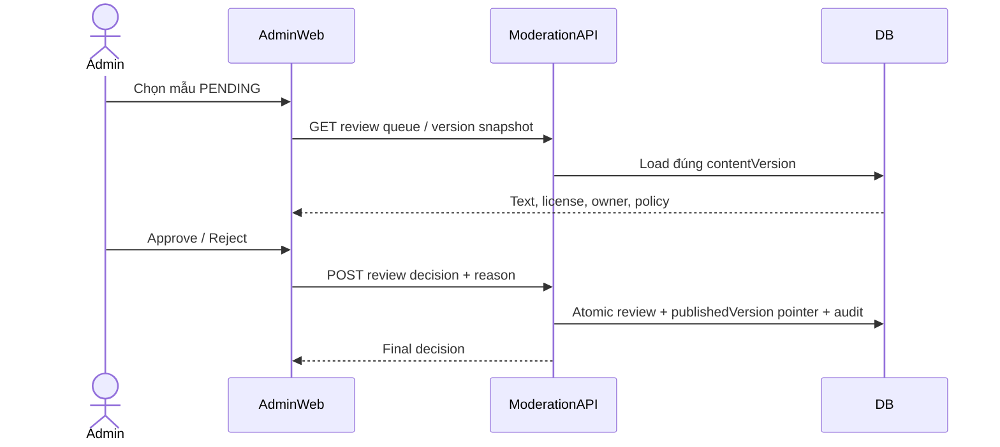
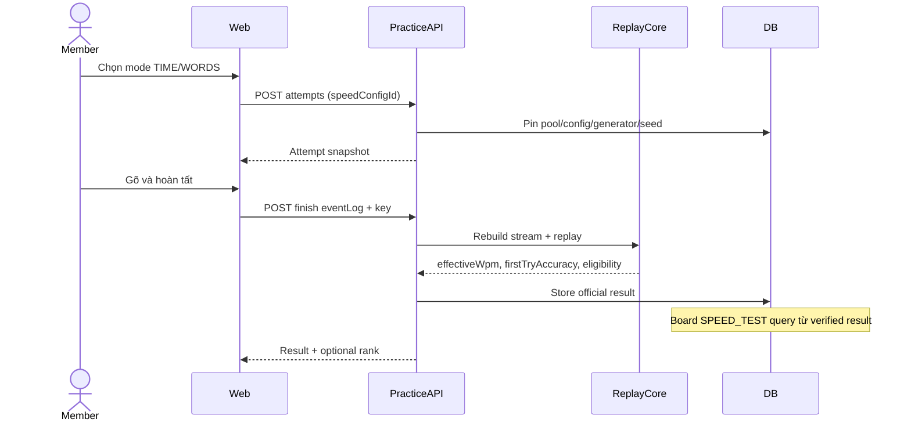
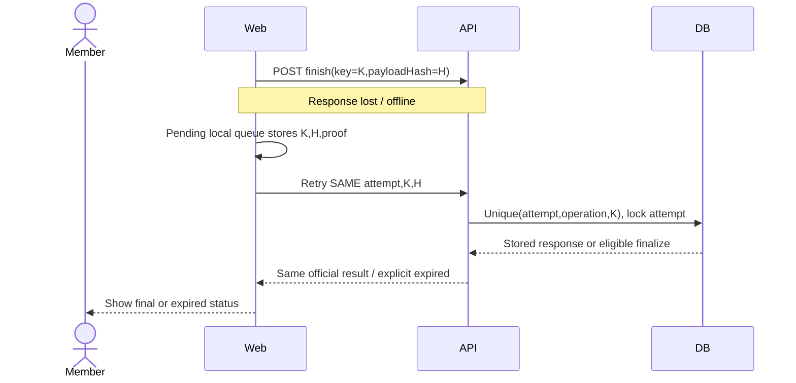

# TYPEPAW — PHÂN TÍCH VÀ THIẾT KẾ HỆ THỐNG

**Phiên bản:** 3.0 · **Ngày:** 15/11/2026 · **Trạng thái:** Đặc tả phân tích và thiết kế, chưa phải mã nguồn triển khai.  
**Nguồn yêu cầu:** ý tưởng gốc được người dùng cung cấp, `pasted.txt`, thiết kế kỹ thuật v1.2, báo cáo Word v2.0 và **10 quyết định sản phẩm được chốt ngày 15/11/2026**. Khi mâu thuẫn, 10 quyết định mới được ưu tiên.  
**Đồng bộ tài liệu:** tệp Markdown này là nguồn nội dung của tệp Word v3.0; Word trình bày sơ đồ dạng hình, Markdown lưu sơ đồ dạng Mermaid có thể chỉnh sửa.  
**Tên dự án:** TypePaw (tên làm việc; cần kiểm tra tên thương hiệu, domain và bản quyền trước khi phát hành công khai).

> **Quy ước phạm vi:** **[MVP]** chức năng dự kiến xây dựng đầu tiên; **[EXT]** chức năng mở rộng được phân tích từ đầu nhưng chưa tạo migration/API hoạt động trong MVP; **[DESIGN]** phương án kỹ thuật đề xuất, chưa phải yêu cầu người dùng tự định nghĩa. Không có kế hoạch 12 tuần.

## 1. Tổng quan, mục tiêu và phạm vi

### 1.1. Bài toán và mục tiêu

TypePaw là website luyện gõ phím kết hợp giáo trình theo bài, kiểm tra tốc độ, trò chơi, mẫu do người dùng tạo, nội dung cộng đồng và quản trị nội dung. Sản phẩm hướng đến người học gõ 10 ngón và người muốn cải thiện tốc độ/chính xác, đồng thời có khả năng mở rộng theo định hướng EdTech/gamification.

- Giao diện tối giản, hiện đại, đồng nhất, ưu tiên **trắng, xám và xanh dương sẫm**; có **Light/Dark theme** và mascot/logo mèo tùy chọn.
- Có nút đổi ngôn ngữ giao diện Việt/Anh; ngôn ngữ UI **khác** với layout bàn phím và ngôn ngữ văn bản luyện.
- **Bắt buộc đăng nhập trước khi luyện bất kỳ Lesson, Speed Test, Game hoặc Template nào**. Khách chỉ được xem giới thiệu, nội dung public ở mức đọc và biểu mẫu xác thực.
- **Tất cả bài học được chọn tự do**; thứ tự Course → Section → Lesson chỉ nhằm gợi ý sư phạm và điều hướng. Không có khóa bài, prerequisite hay placement unlock trong phiên bản sản phẩm này.
- Game MVP chỉ có **Speed Test**. Balloon Pop, Space Shooter và game mới là chức năng mở rộng.
- User tạo Template loại **TEXT** và **GAME_CONTENT** (chỉ thay nội dung đầu vào của game, không tự viết engine hoặc quy tắc điểm). Mẫu public phải do Admin duyệt trước.
- Leaderboard tách **Lessons / Games / Speed Test / Contributors**; không lấy cùng một metric hoặc trộn điểm khác mode.
- **AI chưa được tích hợp**, chỉ dự trù điểm mở rộng và hợp đồng dịch vụ.
- Desktop-first, ưu tiên bàn phím vật lý US QWERTY; mobile xem thông tin nhưng không hỗ trợ phiên tính điểm bằng bàn phím ảo trong MVP.

### 1.2. Tác nhân và quyền

| Tác nhân | Quyền và hành động |
|---|---|
| Guest | Xem Landing, trang đăng nhập/đăng ký; xem danh sách public nếu được cấu hình; **không khởi tạo attempt**. |
| Member | Làm Lessons/Speed Test; xem kết quả, lịch sử, thống kê; tạo/sửa Template, gửi duyệt; duyệt Explore, Leaderboard; quản lý profile/settings. |
| Admin | Quyền Member cộng CRUD giáo trình/game, duyệt mẫu, quản lý user, theme/banner, cấu hình, audit. |
| Moderator [EXT] | Vai trò tách từ quyền Admin khi quy mô đủ lớn; MVP dùng Admin. |
| External Email Service | Gửi mail xác minh và khôi phục tài khoản; không quyết định quyền hệ thống. |
| AI Provider [EXT] | Sinh gợi ý nội dung thông qua backend và kiểm duyệt, không có quyền ghi bảng trực tiếp. |

### 1.3. Phạm vi 10 phân hệ và phân kỳ

| # | Phân hệ | MVP | Mở rộng / ghi chú |
|---|---|---|---|
| 1 | Landing & i18n | Giới thiệu, CTA đăng nhập, đổi ngôn ngữ VI/EN, hình ảnh thương hiệu | CMS blocks và nhiều locale |
| 2 | Auth | Email/password, verify/reset, refresh/logout, phân quyền | Google/Apple OAuth, MFA |
| 3 | Dashboard | Tổng thời gian, tốc độ/độ chính xác, bài đã hoàn thành, lịch sử gần | Streak, gợi ý luyện, heatmap chi tiết |
| 4 | Lessons | Course/Section/Lesson; chọn tự do; KEY_DRILL, REVIEW, PRACTICE, INTRO đơn giản; điểm/sao | PLAY/DYNAMIC, video/quiz phức tạp |
| 5 | Practice UI & Settings | Engine real-time, bàn phím ảo, timer, kết quả, đổi font/size/theme | Telex/VNI, layout khác, phân tích chi tiết |
| 6 | Games | Speed Test theo thời gian/số từ, lưu và chấm kết quả | Balloon Pop, Space Shooter, game engine mới |
| 7 | My Templates | TEXT/GAME_CONTENT, tạo từ mẫu, lưu Private, gửi duyệt, phiên bản | AI assist, import nhiều nguồn |
| 8 | Explore & Rankings | Public templates đã duyệt; phân trang/lọc/sort; 4 bảng xếp hạng SQL | Recommendation, cache Redis, giải đấu |
| 9 | Profile | Hồ sơ, đổi mật khẩu, avatar tùy chọn, cài đặt cá nhân | Xuất dữ liệu tự phục vụ nâng cao |
| 10 | Admin | User, khóa học/bài, template moderation, cấu hình Speed Test, theme/banner cơ bản, audit | Game plugin upload, AI CMS, phân quyền chi tiết |

**Định nghĩa MVP:** phạm vi được đề xuất để triển khai trước, không ràng buộc theo tuần. Các tính năng [EXT] vẫn có Use Case/phân tích dự kiến nhưng không được tự coi là API/schema triển khai ngay.

### 1.4. Điều kiện nghiệp vụ xuyên suốt

- **AUTH-01:** Mọi `POST /practice/attempts` yêu cầu user hợp lệ, email đã xác minh (chính sách MVP) và tài khoản ACTIVE. Không có Guest Speed Test hay guest claim.
- **LESSON-01:** Lesson `PUBLISHED`, `isActive` và có version hiện hành thì user được chọn trực tiếp; không kiểm tra pass bài trước. `courseOrdinal` chỉ là số sắp xếp ổn định.
- **CONTENT-01:** attempt gắn `contentVersionId` và `scoringVersion` bất biến; cập nhật giáo trình/mẫu không sửa attempt cũ.
- **RESULT-01:** Client hiển thị realtime, backend replay event log để tính kết quả chính thức; không tin WPM/score client.
- **TEMPLATE-01:** Mẫu PRIVATE do chủ sở hữu sử dụng; SUBMITTED/PENDING_REVIEW chưa được hiển thị công khai; chỉ APPROVED+PUBLISHED xuất hiện Explore. Admin duyệt **một version cụ thể**.
- **TEMPLATE-02:** GAME_CONTENT chỉ thay `wordPool/text/quote` và các tùy chọn nằm trong whitelist; không sửa cơ chế chiến thắng, tốc độ spawn, điểm hay mã nguồn game.
- **RANK-01:** Bốn leaderboard có công thức và điều kiện tính riêng; mỗi attempt chỉ đóng góp một lần và kết quả không verified không đủ điều kiện xếp hạng.
- **ADMIN-01:** Hành động nhạy cảm được ghi `admin_audit_logs`; không cấp quyền admin từ dữ liệu client.
- **DEVICE-01:** Chỉ tính điểm trên trình duyệt hỗ trợ bàn phím vật lý và khả năng bắt sự kiện cần thiết; phát hiện thiết bị không phù hợp và giải thích rõ.

## 2. Phân tích yêu cầu và thiết kế giao diện

### 2.1. Yêu cầu chức năng và tiêu chí nghiệm thu

| Mã | Yêu cầu | Kiểm tra nghiệm thu |
|---|---|---|
| FR-01 | Đăng ký, đăng nhập, xác minh, quên/đổi mật khẩu | Chặn attempt khi chưa auth/verify; refresh token luân phiên. |
| FR-02 | Landing và chuyển ngôn ngữ giao diện | Đổi VI/EN không làm mất dữ liệu form/đổi nội dung bài đang gõ. |
| FR-03 | Dashboard/historic/progress | Metrics tổng hợp từ attempt/result, lọc thời gian; không cộng điểm bỏ dở. |
| FR-04 | Lesson chọn tự do, phân trang và điều hướng | Bài Published ở bất kỳ thứ tự đều mở; không có cờ LOCKED. |
| FR-05 | Typing Engine và chấm Lesson | Bắt Backspace/Shift/Tab đúng policy; kết quả server replay. |
| FR-06 | Speed Test | Time/Words, punctuation/numbers, seed và ranking hợp lệ. |
| FR-07 | Template TEXT/GAME_CONTENT | Owner tạo/chỉnh sửa/clone; nội dung kiểm tra whitelist. |
| FR-08 | Public Template moderation | Submit → Pending → Approve/Reject → Published; không public khi chưa duyệt. |
| FR-09 | Explore | Public content duyệt, phân trang, lọc TEXT/GAME_CONTENT, mới/cũ/phổ biến. |
| FR-10 | Bốn leaderboard | Điều kiện boardKey + timeWindow + tie-break; SQL không trộn metric. |
| FR-11 | Profile/settings | Đổi font/size/theme/language, password, cập nhật profile. |
| FR-12 | Admin CRUD/versioning/audit | Publish nội dung tạo version mới; duyệt và quản lý tài khoản có audit. |
| FR-13 [EXT] | Game mới và AI | Chỉ ghi hợp đồng mở rộng; không hiển thị nút chức năng giả ở MVP. |

### 2.2. Sitemap và quyền theo màn hình

| Route | Quyền | Nội dung |
|---|---|---|
| `/`, `/login`, `/register`, `/forgot-password`, `/verify-email` | Public | Giới thiệu, xác thực; header có đổi locale. |
| `/app` | Member | Dashboard, chỉ số và lịch sử gần. |
| `/app/lessons`, `/app/lessons/:id`, `/app/lessons/:id/practice` | Member | Danh sách, chi tiết, bài luyện; không khóa bài. |
| `/app/results/:attemptId`, `/app/history`, `/app/progress` | Member owner | Kết quả, lịch sử, tiến độ. |
| `/app/games`, `/app/games/speed-test` | Member | Danh mục game và Speed Test. |
| `/app/templates`, `/app/templates/new`, `/app/templates/:id/edit` | Member owner | Quản lý và gửi duyệt mẫu. |
| `/app/explore`, `/app/templates/:id`, `/app/leaderboards` | Member; Guest có thể xem list public nếu cấu hình | Khám phá, xem mẫu, bốn bảng xếp hạng; Start yêu cầu auth. |
| `/app/profile`, `/app/settings`, `/app/security` | Member | Tài khoản và cài đặt. |
| `/admin/*` | Admin | User, course, lesson, game config, moderation, themes, banners, audit. |
| `/app/games/balloon`, `/app/games/space`, `/app/ai/*` | [EXT] | Không điều hướng như tính năng đang có trong MVP. |

### 2.3. Design System và wireframe mức khung

**Bảng màu đề xuất [DESIGN]:** `#F8FAFC` nền Light, `#FFFFFF` surface, `#0F2742` navy primary, `#334155` slate text, `#2563EB` accent blue, `#D9E4ED` border, `#0B1220` Dark background, `#172638` Dark surface. Các giá trị là đề xuất, có thể đổi qua design tokens. Đạt WCAG AA cho text và focus states, không dùng màu đơn độc để báo đúng/sai.

**Font:** Inter (fallback system UI); code/text luyện phím có thể chọn monospace; UI scale 14–16px, tiêu đề 20–36px; setting thay đổi cỡ chữ luyện độc lập cỡ chữ giao diện. **Mascot mèo:** logo tối giản ở favicon/navbar, mascot minh họa ở Landing/success/empty states; không che vùng luyện gõ.

**Landing:** Header logo + VI/EN + theme + Login/Register; Hero giải thích lợi ích + CTA; khối tính năng Lessons/Speed Test/Templates; footer. **Dashboard:** KPI row, biểu đồ theo ngày, tiến độ Lesson, recent attempts. **Lessons:** bộ lọc khóa/chương/loại, phân trang (cursor/page do UI chọn), item có stars/bestWpm/trạng thái chưa luyện/đã luyện, **không khóa**.

**Practice:** Header tên bài, chế độ, Exit; giữa màn hình văn bản từng ký tự với current cursor, ký tự đúng/sai; dưới là virtual keyboard và gợi ý ngón tay; panel WPM/firstTryAccuracy/timer; Settings (font/size/contrast), Restart, Pause khi mode cho phép. **Result:** status, Effective WPM, First-try Accuracy, Score, Stars, Passed, thống kê lỗi/phím yếu, Retry/New lesson. **Templates/Explore:** tabs TEXT/GAME_CONTENT, lọc/sort/pagination; badge PRIVATE/PENDING/PUBLISHED/REJECTED; nút Submit review; trang xem public có attribution và Report.

**Responsive:** desktop 1280–1440px tối ưu, tablet hiển thị hạn chế, mobile chỉ xem nội dung/biểu đồ; không hỗ trợ chấm điểm bằng virtual keyboard trong MVP; thao tác keyboard accessibility phải có focus/escape. **Theme:** Light/Dark chọn theo user preference, lưu ở user_settings và áp dụng nhất quán sau login.

## 3. Use Case Diagram và danh mục

### 3.1. Use Case tổng quan

```mermaid
flowchart LR
 G[Guest] --> A((UC01 Auth))
 U[Member] --> D((UC02 Dashboard))
 U --> L((UC03 Browse Lessons))
 U --> P((UC04 Practice Lesson))
 U --> S((UC05 Speed Test))
 U --> T((UC06 Manage Templates))
 U --> E((UC07 Explore))
 U --> R((UC08 Leaderboards))
 U --> F((UC09 Profile & Settings))
 P --> Q((UC10 View Result))
 S --> Q
 A1[Admin] --> M((UC11 Manage Lessons & Games))
 A1 --> V((UC12 Review Templates))
 A1 --> X((UC13 Manage Users & Appearance))
 A1 --> Y((UC14 Audit & Config))
 U -.-> Z((UC15 AI & Advanced Games [EXT]))
```

**Quy tắc UML:** Sơ đồ trên là bản đồ use case chức năng dạng flowchart Mermaid để dễ đọc trong Markdown; quan hệ use case không nhằm biểu diễn trình tự thực thi. Admin kế thừa quyền Member; Guest không có cạnh đến Practice/Speed Test.

### 3.2. Danh mục và độ ưu tiên

| ID | Tên Use Case | Tác nhân | Phạm vi |
|---|---|---|---|
| UC01 | Đăng ký/đăng nhập/xác minh/đặt lại mật khẩu | Guest, Member | MVP |
| UC02 | Xem Dashboard và lịch sử | Member | MVP |
| UC03 | Duyệt danh sách bài học, phân trang | Member | MVP |
| UC04 | Luyện Lesson và ghi kết quả | Member | MVP |
| UC05 | Speed Test tính điểm | Member | MVP |
| UC06 | Quản lý Template TEXT/GAME_CONTENT | Member | MVP |
| UC07 | Xem Explore và sử dụng mẫu đã duyệt | Member | MVP |
| UC08 | Xem bốn bảng xếp hạng | Member | MVP |
| UC09 | Cập nhật Profile/Settings/Security | Member | MVP |
| UC10 | Xem kết quả, tiến độ, retry | Member | MVP |
| UC11 | Quản lý giáo trình và Speed Test config | Admin | MVP |
| UC12 | Duyệt/ẩn/từ chối Template public | Admin | MVP |
| UC13 | Quản lý User, Theme, Banner | Admin | MVP |
| UC14 | Xem audit, cấu hình hệ thống | Admin | MVP |
| UC15 | Sinh nội dung AI, Balloon/Space/Playable lesson | Member, Admin | EXT |

## 4. Đặc tả Use Case chi tiết

**Mẫu biểu chung:** ID; tác nhân; tiền điều kiện; kích hoạt; luồng chính; ngoại lệ/luồng thay thế; hậu điều kiện; quy tắc nghiệp vụ. Đây là đặc tả hành vi, không đồng nghĩa mọi endpoint đã được tạo.

### UC01 — Đăng ký và đăng nhập

- **Tác nhân:** Guest, Member; Email Service. **Tiền điều kiện:** Email hợp lệ, tài khoản chưa bị khóa. **Kích hoạt:** Chọn Register/Login.
- **Luồng chính:** (1) Nhập thông tin; (2) backend validate, hash password, lưu User/verification token; (3) gửi email xác minh; (4) xác minh token một lần; (5) đăng nhập; (6) server phát access token ngắn hạn và refresh cookie HttpOnly; (7) chuyển Dashboard.
- **Ngoại lệ:** Email trùng/không xác minh → 409/403; sai password → 401; account suspended → 423; quá số lần thử → 429; email lỗi → cho gửi lại theo giới hạn, không tạo account vô hạn.
- **Hậu điều kiện:** Phiên hợp lệ được lưu; refresh có rotation; mọi attempt bị chặn trước auth.

### UC02 — Xem Dashboard / lịch sử

- **Tác nhân:** Member. **Tiền điều kiện:** Login. **Kích hoạt:** Mở `/app`.
- **Luồng chính:** (1) GET KPI theo khoảng thời gian; (2) tính total active duration, weighted WPM/accuracy từ kết quả hợp lệ; (3) lấy lịch sử gần nhất gồm COMPLETED/ABANDONED/EXPIRED nếu có; (4) trả chart và link xem result.
- **Ngoại lệ:** Chưa có dữ liệu → empty state; lỗi mạng → retry; không tiết lộ lịch sử user khác.
- **Hậu điều kiện:** Không làm thay đổi điểm hay tiến độ.

### UC03 — Duyệt Lessons tự do

- **Tác nhân:** Member. **Tiền điều kiện:** Login. **Kích hoạt:** Mở Lessons.
- **Luồng chính:** (1) GET course/section; (2) danh sách bài published theo `courseOrdinal`, có pagination/filter; (3) hiển thị trạng thái chưa luyện, best stars, best WPM; (4) chọn **bất kỳ** bài published; (5) hiển thị mục tiêu và Start.
- **Ngoại lệ:** Bài DRAFT/ARCHIVED hoặc target chưa publish → 404/410; user không có quyền → 401; **không trả `LESSON_LOCKED` vì thứ tự không phải điều kiện truy cập**.
- **Hậu điều kiện:** Không tạo attempt trước khi Start.

### UC04 — Luyện Lesson và hoàn tất

- **Tác nhân:** Member. **Tiền điều kiện:** User ACTIVE, Lesson PUBLISHED, thiết bị phù hợp. **Kích hoạt:** Start.
- **Luồng chính:** (1) POST attempts; (2) server pin immutable contentVersion và config; (3) client engine gõ và ghi event log; (4) finish với Idempotency-Key; (5) server lock attempt, validate và replay, tính score/stars; (6) commit result/progress; (7) hiển thị kết quả.
- **Ngoại lệ:** Paste/IME/chứng cứ sai → invalid/ineligible; hết hạn → EXPIRED; mất kết nối → local pending retry trong TTL; double finish → trả response cũ hoặc conflict có mã rõ; INTRO có xác nhận bước thay cho WPM.
- **Hậu điều kiện:** Một attempt chỉ có một terminal result; best stars/score chỉ được cập nhật nếu tốt hơn.

### UC05 — Làm Speed Test

- **Tác nhân:** Member. **Tiền điều kiện:** Login, device support. **Kích hoạt:** Chọn mode TIME hoặc WORDS và Start.
- **Luồng chính:** (1) chọn thời lượng/số từ, punctuation/numbers; (2) server cấp seed + wordPoolVersion + policy; (3) client tạo text xác định và ghi log; (4) kết thúc theo time/words; (5) server tái dựng và replay; (6) trả WPM/accuracy, status và eligibility; (7) cập nhật Speed Test leaderboard.
- **Ngoại lệ:** tab hidden, chỉnh đồng hồ client, event không hợp lệ → không ranked; đổi cấu hình giữa attempt → phải tạo attempt khác.
- **Hậu điều kiện:** Lưu lịch sử như một attempt mode SPEED; không cộng điểm vào Lesson.

### UC06 — Tạo và quản lý Template

- **Tác nhân:** Member. **Tiền điều kiện:** Login. **Kích hoạt:** Create/Clone/Edit.
- **Luồng chính:** (1) chọn TEXT hoặc GAME_CONTENT; (2) nhập nội dung hoặc clone một nguồn được phép; (3) validate độ dài, ký tự và license; (4) lưu bản PRIVATE và content version; (5) preview/luyện; (6) Submit Review nếu muốn public.
- **Ngoại lệ:** Không có quyền clone/licensing; payload có script hoặc game rule không trong whitelist → 422; vượt quota → 429; chỉnh mẫu Published tạo draft version mới.
- **Hậu điều kiện:** Chủ sở hữu quản lý mẫu; PENDING không public; attempt cũ vẫn gắn version cũ.

### UC07 — Khám phá Template công khai

- **Tác nhân:** Member (Guest có thể xem metadata nếu cấu hình). **Tiền điều kiện:** Có mẫu Approved/Published. **Kích hoạt:** Explore.
- **Luồng chính:** (1) GET Explore với type/sort/cursor; (2) chọn template; (3) xem thông tin tác giả, loại và số lượt đã xác minh; (4) Member chọn Practice; (5) server tạo attempt từ approved version.
- **Ngoại lệ:** Bị Hidden/Removed → 404; Guest bấm Practice → redirect Login, không tạo attempt; query sort không hợp lệ → 400.
- **Hậu điều kiện:** View không tăng starts; chỉ attempt bắt đầu hợp lệ mới tính starts, hoàn tất mới tính completions.

### UC08 — Xem bảng xếp hạng

- **Tác nhân:** Member. **Tiền điều kiện:** Login. **Kích hoạt:** Leaderboards.
- **Luồng chính:** (1) chọn board Lessons/Games/Speed/Contributors và timeWindow; (2) server query riêng theo board; (3) áp tie-break; (4) trả danh sách, vị trí user và thời điểm cập nhật.
- **Ngoại lệ:** Board Games có thể trống trong MVP vì chỉ có Speed Test và **Speed không gộp vào Games**; request board không xác định → 400; dữ liệu flagged → không ranked.
- **Hậu điều kiện:** Chỉ đọc. Contributors dựa trên mẫu public hợp lệ và unique completed players, không tăng theo views.

### UC09 — Quản lý hồ sơ và cài đặt

- **Tác nhân:** Member. **Tiền điều kiện:** Login. **Kích hoạt:** Open Profile/Settings.
- **Luồng chính:** (1) GET `/me`; (2) sửa displayName/avatar nếu bật; (3) đổi UI language, light/dark, font/size/text mode; (4) PATCH settings; (5) đổi mật khẩu qua re-auth khi cần.
- **Ngoại lệ:** Sai mật khẩu cũ → 401; cỡ chữ ngoài khoảng → 422; avatar sai MIME → 415. **Hậu điều kiện:** Cài đặt áp dụng qua các lần đăng nhập.

### UC10 — Xem kết quả và retry

- **Tác nhân:** Member. **Tiền điều kiện:** Có attempt thuộc owner. **Kích hoạt:** Finish hoặc History.
- **Luồng chính:** (1) GET result; (2) hiển thị Effective WPM, firstTryAccuracy, score/stars (nếu Lesson), lỗi phím; (3) Retry tạo **attempt mới** cùng target/version hiện hành; (4) lịch sử cũ không bị ghi đè.
- **Ngoại lệ:** ABANDONED có partial metrics và score 0; EXPIRED không tự tính rank; thiếu ownership → 403. **Hậu điều kiện:** Retry không chỉnh result cũ.

### UC11 — Admin quản lý Lessons và Speed Test

- **Tác nhân:** Admin. **Tiền điều kiện:** Quyền ADMIN. **Kích hoạt:** CRUD/publish.
- **Luồng chính:** (1) tạo Course/Section/Lesson; (2) chỉnh lessonType/config/goal; (3) kiểm tra rule, content, ngưỡng điểm, tính hợp lệ; (4) publish immutable ContentVersion; (5) cập nhật pointer target; (6) audit. Với Speed Test, quản lý word pools/config cho mode được whitelist.
- **Ngoại lệ:** Nội dung không hợp lệ/duplicated ordinal → 422/409; version đã dùng bởi attempt không được sửa trực tiếp. **Hậu điều kiện:** Lesson published xuất hiện tự do cho Member, không unlock.

### UC12 — Admin duyệt mẫu public

- **Tác nhân:** Admin. **Tiền điều kiện:** Template status PENDING_REVIEW. **Kích hoạt:** Review Queue.
- **Luồng chính:** (1) lấy hàng đợi; (2) đọc version snapshot + metadata/nguồn; (3) Approve hoặc Reject cùng reason; (4) transaction cập nhật status/publishedVersionId; (5) audit; (6) mẫu được lên Explore khi approved.
- **Ngoại lệ:** Hai admin duyệt đồng thời → optimistic lock / 409; vi phạm license → reject; user sửa sau submit → cần submit lại version mới. **Hậu điều kiện:** Chỉ version duyệt được công khai.

### UC13 — Quản lý User, Theme, Banner

- **Tác nhân:** Admin. **Tiền điều kiện:** ADMIN. **Kích hoạt:** Admin Portal.
- **Luồng chính:** (1) tìm User theo trạng thái; (2) suspend/restore theo chính sách; (3) quản lý theme tokens và banner metadata cho landing; (4) validate asset, URL, lịch hiển thị; (5) audit thay đổi.
- **Ngoại lệ:** Admin không tự vô hiệu hóa tài khoản admin cuối; không gắn script/URL nguy hiểm vào banner; suspend thu hồi refresh sessions. **Hậu điều kiện:** Cấu hình được cache/reload hợp lệ, có lịch sử audit.

### UC14 — Quản trị audit và cấu hình

- **Tác nhân:** Admin. **Tiền điều kiện:** ADMIN. **Kích hoạt:** Audit/Config.
- **Luồng chính:** (1) lọc audit theo actor/action/date; (2) đọc before/after đã loại secrets; (3) chỉnh các giới hạn được whitelist như template length/rate limit/leaderboard period; (4) ghi audit của thao tác cấu hình.
- **Ngoại lệ:** Không được chỉnh audit log trực tiếp; dữ liệu nhạy cảm phải ẩn. **Hậu điều kiện:** Có trace phục vụ hỗ trợ vận hành.

### UC15 — AI và game mở rộng [EXT]

- **Tác nhân:** Member, Admin. **Tiền điều kiện:** Feature flag bật, provider/game type đã duyệt. **Luồng dự kiến:** AI nhận yêu cầu qua backend, quota, kiểm tra output, cho user duyệt trước khi lưu Template; Balloon/Space sử dụng game engine/version và scorer riêng, Template chỉ thay nội dung. **Ngoại lệ:** API key không lộ client, nội dung AI chưa có license rõ không được public tự động. **Hậu điều kiện:** Không coi đây là MVP; schema/API chỉ là hợp đồng định hướng.

## 5. Class Diagram và mô hình miền

### 5.1. Domain Class Diagram



**Đọc sơ đồ:** Lesson và Template là hai loại owner của PracticeTarget; không có FK `custom_templates.targetId` ngược chiều. Game template tham chiếu game type đã whitelist. `LeaderboardDefinition` là read model/config, không bắt buộc phải lưu leaderboard_entries trong MVP.

### 5.2. Application/Typing Core Class Diagram



**Nguyên tắc triển khai:** `typing-core` là TypeScript thuần dùng lại ở client và server, không phụ thuộc React, DOM hoặc NestJS. Các service xử lý orchestration, repository và transaction; không đưa HttpController vào Domain Class Diagram.

## 6. Database / ERD và thiết kế schema

### 6.1. Nguyên tắc chuẩn hóa

1. PostgreSQL + Prisma; PK UUID, UTC `timestamptz`; index theo truy vấn và FK; soft-delete theo retention ở những bảng có lịch sử.
2. `practice_attempts.contentVersionId NOT NULL`; **không có attemptSnapshotId**. `practice_targets.currentContentVersionId` là một pointer đến version thuộc chính target.
3. `custom_templates` không có `targetId`; `practice_targets.customTemplateId` là FK một chiều. Với hai owner MVP, CHECK chính xác **một trong** `lessonId`, `customTemplateId`, hoặc `speedConfigId` (Speed config có thể là bảng riêng). Khi mở rộng game thêm `gameId` bằng migration và cập nhật CHECK; tránh FK đa hình `(type,id)` không thể enforce.
4. `lessons.courseId` tồn tại, composite FK đảm bảo Section cùng Course; `courseOrdinal` chỉ sắp xếp, **không có prerequisite, placement_assessments hay unlock** trong sản phẩm đã chốt.
5. Attempts/Results/Progress tách riêng. Lesson score chỉ cập nhật **best per lesson**, không cộng điểm vô hạn khi replay. Rankings SQL query từ dữ liệu verified, dùng materialized view khi có nhu cầu, chưa cần Redis/outbox.
6. Public Template dùng version review riêng; `publishedContentVersionId` chỉ được set khi Admin approve version. Public có thể dùng `practice_targets.currentContentVersionId` nhưng chỉ duyệt version riêng; tránh hiển thị draft.
7. Speed Test phải có target/config version bất biến; không coi Speed Test là Lesson hoặc Games leaderboard chung.

### 6.2. ERD nghiệp vụ — Core, Content, Community



### 6.3. Danh mục bảng MVP (24 bảng đề xuất; không ép số lượng)

| # | Bảng | Các trường chính / ràng buộc | Mục đích |
|---|---|---|---|
| 1 | `users` | id, email UNIQUE, username UNIQUE, passwordHash, role, status, deletedAt | Account và phân quyền |
| 2 | `refresh_sessions` | id, userId FK, tokenHash UNIQUE, expiresAt, revokedAt | Refresh rotation |
| 3 | `verification_tokens` | id, userId FK, purpose, tokenHash, expiresAt, usedAt | Verify/reset token |
| 4 | `user_settings` | userId PK/FK, uiLanguage, theme, typingFont, fontSize, prefsJson | Theme, locale, preference |
| 5 | `courses` | id, slug UNIQUE, title, status | Khóa học |
| 6 | `sections` | id, courseId FK, orderIndex, UNIQUE(courseId,orderIndex), UNIQUE(id,courseId) | Chương |
| 7 | `lessons` | id, courseId FK, sectionId FK, courseOrdinal, lessonType, goalWpm, policyJson, status; UNIQUE(courseId,courseOrdinal) | Bài học **không có unlock** |
| 8 | `speed_test_configs` | id, mode, timeLimit/wordTarget, punctuation, numbers, wordPoolVersion, status | Cấu hình Speed Test |
| 9 | `practice_targets` | id, lessonId FK NULL, customTemplateId FK NULL, speedConfigId FK NULL, currentContentVersionId; exactly-one owner CHECK | Target duy nhất |
| 10 | `content_versions` | id, targetId FK, versionNo, contentKind, text/configJson, hash; UNIQUE(targetId,versionNo) | Snapshot bất biến |
| 11 | `practice_attempts` | id, userId FK NOT NULL, targetId FK, contentVersionId FK, mode, status, configSnapshot, scoringVersion, typingCoreVersion, timing | Phiên luyện |
| 12 | `practice_results` | attemptId PK/FK, effectiveWpm, firstTryAccuracy, score, stars, passed, eligibleForRanking, metricJson | Kết quả chính thức |
| 13 | `practice_key_stats` | attemptId FK, keyLabel, attempts, correctFirstTry, mistakes, avgLatency; PK(attemptId,keyLabel) | Phím yếu |
| 14 | `lesson_progress` | userId FK, lessonId FK, bestScore, bestStars, bestWpm, passedAt, attemptsCount; PK(userId,lessonId) | Tổng hợp Lesson |
| 15 | `custom_templates` | id, creatorId FK, title, type TEXT/GAME_CONTENT, status, visibility, gameTypeKey NULL, publishedVersionId NULL, deletedAt | Mẫu cá nhân / cộng đồng |
| 16 | `template_reviews` | id, templateId FK, contentVersionId FK, reviewerId FK, decision, reason, reviewedAt | Admin phê duyệt version |
| 17 | `template_play_events` | attemptId FK, templateId FK, eventType STARTED/COMPLETED, userId FK, UNIQUE(attemptId,eventType) | Tính lượt thực dùng |
| 18 | `template_reports` | id, templateId FK, reporterId FK, reason, status, createdAt | Report nội dung |
| 19 | `practice_partial_snapshots` | attemptId PK/FK, cursor, activeTimeMs, partialMetricJson, capturedAt | Phiên bỏ dở |
| 20 | `attempt_finalization_requests` | attemptId FK, operation, key, requestHash, responseJson, UNIQUE(attemptId,operation,key) | Retry/idempotency |
| 21 | `admin_audit_logs` | id, actorId FK, action, targetType, targetId, beforeJson, afterJson, createdAt | Truy vết quản trị |
| 22 | `themes` | id, key UNIQUE, tokensJson, isActive | Theme tokens/cấu hình |
| 23 | `banners` | id, title, imageUrl, targetUrl, status, publishedFrom/To | Landing banner |
| 24 | `site_settings` | key PK, valueJson, updatedBy, updatedAt | Locale, quotas, hạn mức |

**Lưu ý khi triển khai:** 24 bảng là phạm vi đề xuất theo yêu cầu MVP rộng hơn v1.2 (có moderation, leaderboard, theme/banner), không còn mốc cũ 18 bảng. Bảng `speed_test_configs` có thể dẫn tới Target/CV; khi seed target Speed Test phải tạo ContentVersion chứa word pool/PRNG config bất biến, nội dung cụ thể của mỗi attempt được tái tạo bằng seed được pin trong `configSnapshot`. Dùng SQL `CHECK`/composite FK bổ sung khi Prisma chưa biểu diễn đủ.

### 6.4. Các quan hệ và constraint quan trọng

- `sections UNIQUE(id,courseId)` và `lessons(sectionId,courseId) -> sections(id,courseId)`; `lessons UNIQUE(courseId,courseOrdinal)`; `orderIndex` chỉ trong một section.
- `practice_targets` có partial UNIQUE trên `lessonId`, `customTemplateId`, `speedConfigId`; một target có đúng một owner. `content_versions.targetId` và `currentContentVersionId` hợp lệ theo target; thiết kế migration cần giải quyết pointer nullable lúc tạo và cập nhật sau trong transaction.
- `practice_attempts(userId,targetId,contentVersionId)` lưu nguyên version và owner; `practice_results.attemptId` UNIQUE; terminal result không được thay đổi về metric.
- `template_reviews` duyệt **exact contentVersionId** trùng target của template; status decision recorded; `custom_templates.publishedVersionId` tham chiếu version duyệt. Admin không được duyệt dựa trên mỗi templateId.
- `template_play_events` chỉ insert khi attempt hợp lệ; tự luyện mẫu của mình không tính vào contributor ranking; `uniquePlayerCount = COUNT(DISTINCT userId)` cho COMPLETED verified theo từng creator với lọc self-play.
- Không giữ bảng `leaderboard_entries` trộn nhiều loại ranking trong MVP: dùng view/query SQL cho từng board; mỗi bảng xác định rõ policy và tie-break.
- Index gợi ý: attempts `(userId,createdAt DESC)`, result `(eligibleForRanking,effectiveWpm DESC)`, lessons `(courseId,courseOrdinal)`, templates `(status,visibility,createdAt DESC)`, reviews `(decision,createdAt)`, play events `(templateId,eventType,userId)`.

### 6.5. Bảng mở rộng [EXT] (chưa migrate ở MVP)

`games` (cấu hình engine/plugin), `game_versions`, `game_sessions` nếu engine riêng; `ai_generation_jobs`, `ai_usage_quotas`, `oauth_identities`, `report_moderation_actions`, `ranking_snapshots`, `user_data_export_jobs`, `notification_events`. Không tạo bảng `lesson_prerequisites`, `placement_assessments` hoặc `course_placement_unlocks` vì **không có yêu cầu khóa bài**.

### 6.6. Ma trận truy xuất nguồn dữ liệu

| Chỉ số | Nguồn dữ liệu chính | Tránh sai lệch |
|---|---|---|
| Dashboard recent | attempts + results + partial snapshots | Không giả mạo score cho ABANDONED |
| Best Lesson | lesson_progress (tái tính được từ verified results) | Chỉ best per lesson, không farm replay |
| Board Lessons | tổng bestScore mỗi lesson của mỗi user | Không SUM mọi attempt |
| Board Speed Test | best verified `effectiveWpm` theo config/period + accuracy tie-break | Không trộn time/words nếu policy khác |
| Board Games [EXT] | normalized score theo gameId/gameRuleVersion | MVP hiển thị empty state, không trộn Speed |
| Board Contributors | distinct verified player hoàn tất trên public templates mỗi creator | Không cộng views/tự chơi/đếm trùng user |

## 7. Typing Engine, scoring và quy tắc bài học

### 7.1. Kiến trúc engine

- Gói `packages/typing-core`: pure reducer `(state,event)->state`, state bất biến hoặc functional update, không đọc `window` trực tiếp.
- Client thực thi realtime; API chỉ nhận event proof khi finish/abandon. Server replay từ snapshot content+config pin tại start.
- Event chuẩn `{seq, kind, char?, activeTimeMs, shift?, capsLock?}`; `INSERT`, `BACKSPACE`, `PAUSE`, `RESUME`, `TIMEOUT`. Thời gian bắt đầu ở first input hợp lệ; monotonic, pause không tính vào active duration theo policy. Dùng `performance.now()` phía client nhưng server đối chiếu wallclock server.
- Mỗi lần gõ ghi `attemptedPositions` để tránh Backspace reset first-try; dấu vết mỗi vị trí tuyệt đối không reuse ở Speed Time; Backspace chỉ thay buffer cuối, không xóa lịch sử lỗi.
- Input thật, `beforeinput/input/composition` xử lý chữ; `keydown` riêng Tab/Shift; Tab chỉ capture khi lesson target là `\t`, đang focus và policy yêu cầu, có Esc thoát focus; Caps Lock không chặn mọi bài, chỉ kiểm tra khi `REQUIRE_SHIFT`. MVP không tính điểm gõ IME/mobile không được xác minh.
- `finalCorrectCount` là số vị trí đúng còn tồn tại; `creditedUniqueCorrectCount` chỉ telemetry; `scoredCorrectCount` theo mode từ kết quả cuối, **không** lấy tổng số ký tự từng đúng. `firstTryAccuracy` giữ lịch sử lần gõ đầu, không reset bởi Backspace.

### 7.2. Metric và ví dụ chống farm

Với `minutes=activeDurationMs/60000` và mẫu số > 0:

```text
grossWpm = insertedCount / (5 * minutes)                         // analytics
rawAccuracy = 100 * (insertedCount - mistakeCount) / insertedCount
firstTryAccuracy = 100 * correctFirstTryCount / distinctAttemptedPositionCount
accuracyFinal = 100 * finalCorrectCount / (finalCorrectCount + finalIncorrectCount)
effectiveWpm = scoredCorrectCount / (5 * minutes)                // chấm điểm/xếp hạng
```

Trường hợp không đủ `minDurationMs`, invalid `eventLog`, event sau terminal hoặc không đúng chính sách device → `eligibleForRanking=false`, có thể trả metric `null` thay vì chia 0. **Phản chứng:** gõ `a`, Backspace, `a` 100 lần, `insertedCount` tăng nhưng `scoredCorrectCount` cuối là 1; không farm Speed/Score. Gõ `abc` rồi xóa `bc`: `creditedUniqueCorrectCount=3` nhưng `finalCorrectCount=1`.

### 7.3. Hoàn thành, qua bài, điểm và sao

- Lesson TEXT (`KEY_DRILL`, `REVIEW`, `PRACTICE`) chỉ `COMPLETED` khi cursor cuối và **không còn vị trí sai** (sau sửa nếu cho Backspace), đạt min duration; `passed` độc lập với terminal, dựa trên `firstTryAccuracy >= minAccuracy` và `effectiveWpm >= minPassWpm`.
- `INTRO` đơn giản có config các bước/acknowledgment; không áp min WPM. Có thể lưu `passed=true`, `score=0`, `stars=0/1` theo policy publish rõ ràng.
- Sao typing **đề xuất [DESIGN]**: +1 hoàn thành hợp lệ; +1 nếu firstTryAccuracy ≥ 90%; +1 nếu ≥95%; +1 nếu effectiveWpm ≥ 0.8×goalWpm; +1 nếu ≥goalWpm. Admin validator phải check threshold policy và ngưỡng không mâu thuẫn; không coi `minPassWpm ≤ 0.8×goalWpm` là định lý bắt buộc.
- **Score Lesson:** bản MVP đề xuất `score = round(100 × clamp(effectiveWpm/goalWpm,0,1.5) × clamp(firstTryAccuracy/100,0,1))`, không tính nếu invalid; `bestScore` theo lesson để tránh farm. Công thức này là quyết định thiết kế cần khóa version trước khi code; đạt điểm tối đa có thể 150, giao diện phải ghi thang điểm rõ.
- **Speed Test:** Time/Words hoàn thành theo điều kiện riêng, `effectiveWpm` là metric rank chính; chữ chưa sửa tại time cutoff không tính vào scoredCorrect. Có thể không có stars/score Lesson. Không cộng Score Speed sang Lesson.
- **Games [EXT]:** score rule riêng theo engine, dùng normalized score trong board Games; không áp Lesson WPM thô. **GAME_CONTENT Template:** dùng scorer của game chủ, không thay rule.

### 7.4. Trạng thái, session và replay

`READY → RUNNING ↔ PAUSED → COMPLETED/FAILED/ABANDONED/EXPIRED`; `READY` có thể `ABANDONED`; `PAUSED` chỉ khi mode cho phép. Trong DB `COMPLETED` là đã chấm hợp lệ nhưng `passed` có thể false. Mất mạng khi finish: lưu pending payload+key cục bộ, retry **cùng attemptId, same key và request hash** trong TTL; request trễ quá `expiresAt` có thể bị EXPIRED, không cấp điểm.

- `attemptId` định danh phiên; `Idempotency-Key` định danh yêu cầu kết thúc. `UNIQUE(attemptId,operation,key)`; lock row attempt và commit result/progress/response trong một transaction. Không cho 2 tab finalize cùng attempt thành hai kết quả.
- Event log bắt buộc cho Lesson scored và Speed Test (MVP mọi mode scored); reject seq trùng, timestamp đảo, char nhiều ký tự trái policy, payload quá lớn; giới hạn ví dụ 10.000 events/256 KiB sau giải nén là cấu hình test, không mặc định thích hợp mọi bài.
- Replay giúp kiểm tra **nhất quán nội bộ**, không chứng minh gõ phím thật hay ngăn bot giả log. Server so `startedAt/expiresAt`, elapsed server, rules/version. Không log phím ngoài practice input.
- `abandon` có thể lưu `practice_partial_snapshots` với metrics tạm được replay và nhãn *chưa hoàn thành*; không sinh `practice_results` đủ điều kiện xếp hạng.

### 7.5. Điểm theo từ, luyện theo phím và accessibility

- `wordMetrics` gồm wordIndex/start/end/firstInputAt/lastInputAt/errorCount/duration/WPM; WPM theo từ có `minDuration` tránh spike, trạng thái đang gõ là provisional.
- Visual keyboard US-QWERTY + finger map; màu chính phản ánh đúng/sai, heatmap tốc độ là lớp phụ bật/tắt được; không dùng chỉ màu để thông báo.
- Lesson gõ Tab: chỉ `preventDefault` khi đúng target `\t`, có Esc và nút thoát vùng gõ; Shift key theo event modifier, không xác minh được ngón tay thật. IME tiếng Việt dự kiến [EXT] cần grapheme/NFC/Telex/VNI policy riêng.

## 8. Leaderboard, cộng đồng và quản trị nội dung

### 8.1. Chính sách bốn bảng xếp hạng

| Board | Metric chính | Điều kiện | Tie-break |
|---|---|---|---|
| `LESSONS_TOTAL` | `SUM(bestScore)` theo các lesson PUBLISHED thuộc course/period được cấu hình | Verified Lesson result; mỗi lesson tính best một lần | SUM(bestStars), tổng eligible duration thấp hơn nếu cần, userId |
| `SPEED_TEST` | Best `effectiveWpm` theo cùng speedConfig/mode/period | Mode, config version và anti-cheat eligibility tương thích | firstTryAccuracy, timestamp kết quả sớm hơn, userId |
| `GAMES_TOTAL` [EXT] | SUM normalized best game scores theo game/rule version | Chỉ game engines triển khai; **không gộp Speed Test** | số game đã chơi hợp lệ, userId |
| `CONTRIBUTORS` | số unique verified users hoàn tất template public của tác giả | Exclude self-play, bot/invalid, private, hidden/removed theo policy | completed attempts, số template public, userId |

**TimeWindow:** `all_time`, `monthly`, `weekly` theo UTC hoặc timezone công bố; Board Lessons `all_time` dùng `lesson_progress`, còn weekly/monthly phải **tính best Lesson từ các results trong khoảng** thay vì lấy best all_time. Không cộng bonus theo số lần spam bài. Board Games MVP hiển thị trạng thái *Sắp ra mắt/Chưa có dữ liệu*, không tổng hợp Speed Test vào Games.

### 8.2. Template moderation, version và quyền

`DRAFT_PRIVATE → PENDING_REVIEW → APPROVED_PUBLISHED` hoặc `REJECTED`; Admin có thể `HIDDEN` và user có thể `ARCHIVED`. Khi user sửa mẫu đã public: tạo **draft content version mới**, bản public cũ chỉ tiếp tục hiển thị theo policy cho đến khi Admin duyệt phiên bản mới; user có thể chọn gỡ public ngay. Tính quyền xem attempt theo owner/admin và trạng thái version.

- `TEXT`: chỉ văn bản được whitelist, độ dài và source license. `GAME_CONTENT`: `gameTypeKey` thuộc danh sách engine, fields cho phép `wordPool`, `quotes`, `difficultyPreset` nếu game chủ hỗ trợ; **không cho sửa engine logic, JS, score, spawn rate**.
- `usageCount` không tăng khi GET chi tiết; STARTED một lần từ attempt hợp lệ; COMPLETED khi verified finish, unique players tính distinct user hoàn tất. Public display sử dụng số đếm được tính lại từ play events hoặc materialized summary.
- Cho report vi phạm; moderation log có lý do; rate limits cho submissions; script injection/XSS phải được sanitize/escape, không tự động tin AI hoặc nguồn quote.

### 8.3. Giáo trình và nguồn nội dung

- Cấu trúc import chuẩn hóa JSON/YAML: `course{slug,title,locale,sections:[{key,order,lessons:[{slug,courseOrdinal,type,content,config,goalWpm,minAccuracy}]}]}`. Script `validate → dry-run diff → transaction upsert draft → publish version theo batch`; kiểm tra slug, thứ tự unique, key-map US QWERTY, nội dung trống/không hợp lệ, ngưỡng score, số ký tự tối đa, duplicate và copyright source.
- Ý tưởng ban đầu nhắc giáo trình lớn (khoảng 685 bài), **chưa được coi là đã soạn/kiểm chứng đủ**. Khi chưa có nội dung đầy đủ, seed tập bài mẫu nhỏ theo Home/Top/Bottom Rows, Shift, Numbers, Symbols để test flows.
- Metadata nguồn `sourceName`, `sourceUrl`, `license`, `attribution`, `approvedBy`, `approvedAt` là bắt buộc khi dùng nội dung bên thứ ba. Không sao chép nguyên văn đoạn trích có bản quyền nếu chưa có phép.

## 9. Sequence Diagram — các luồng chính

### 9.1. Đăng nhập và refresh



### 9.2. Bắt đầu bất kỳ Lesson đã publish



### 9.3. Finish và chấm ở server



### 9.4. Tạo Template và gửi duyệt



### 9.5. Admin duyệt mẫu public



### 9.6. Explore → sử dụng Template công khai

```mermaid
sequenceDiagram
 actor Member
 participant Web
 participant ExploreAPI
 participant PracticeAPI
 participant DB
 Member->>Web: Filter/Sort Explore và chọn mẫu
 Web->>ExploreAPI: GET /explore/templates?type&sort&cursor
 ExploreAPI->>DB: Approved/PUBLISHED only
 ExploreAPI-->>Web: Page + attribution + popularity
 Member->>Web: Practice template
 Web->>PracticeAPI: POST /practice/attempts targetId
 PracticeAPI->>DB: Pin approved version; insert STARTED
 PracticeAPI-->>Web: attemptId + snapshot
 Note over DB: COMPLETED only after verified finish
```

### 9.7. Speed Test và cập nhật ranking



### 9.8. Mất mạng và retry không cộng trùng



## 10. API Contract REST v1 (định hướng OpenAPI)

### 10.1. Chuẩn chung

- Prefix `/v1`, JSON, UTC ISO8601. Authentication Bearer access token; HttpOnly Secure refresh cookie (chốt SameSite theo domain deployment). DTO whitelist/validate; response `{data,meta:{requestId}}`; error `{error:{code,message,details,requestId}}`.
- API theo role, owner checks và RBAC. Phân trang `cursor`/`limit` có trần; sort whitelist; `Idempotency-Key` cho endpoint terminal và moderation nhạy cảm khi cần.
- Không có API Guest practice, guest claim, lesson unlock hoặc placement. Public GET không được dùng để suy luận rằng Guest có quyền start.

### 10.2. Endpoint chính

| Method | Endpoint | Actor | Chức năng |
|---|---|---|---|
| POST | `/v1/auth/register`, `/login`, `/refresh`, `/logout` | Guest/Member | Tài khoản/session |
| POST | `/v1/auth/verify-email`, `/forgot-password`, `/reset-password` | Guest | Xác minh/khôi phục |
| GET/PATCH | `/v1/me`, `/v1/me/settings` | Member | Profile và theme/font/language |
| POST | `/v1/me/password` | Member | Đổi password sau re-auth |
| GET | `/v1/courses`, `/v1/courses/:id/sections`, `/v1/lessons?courseId&cursor` | Member | Duyệt tự do/phân trang |
| GET | `/v1/lessons/:id`, `/v1/me/progress`, `/v1/me/history`, `/v1/me/stats` | Member | Lesson và analytics |
| GET | `/v1/games`, `/v1/speed-test/configs` | Member | Speed Test ở MVP |
| POST | `/v1/practice/attempts` | Member | Pin contentVersion, không check unlock |
| POST | `/v1/practice/attempts/:id/finish`, `/abandon` | Member | Replay, terminal, idempotency |
| GET | `/v1/practice/attempts/:id` | Member owner/Admin | Result/partial |
| GET/POST | `/v1/templates` | Member | List/create TEXT/GAME_CONTENT |
| GET/PATCH/DELETE | `/v1/templates/:id` | Owner | View/edit/archive |
| POST | `/v1/templates/:id/submit-review` | Owner | Gửi duyệt specific version |
| GET | `/v1/explore/templates`, `/v1/leaderboards` | Member; public view tùy chính sách | Explore + 4 boards |
| POST | `/v1/templates/:id/report` | Member | Report mẫu công khai |
| GET/POST/PATCH | `/v1/admin/courses`, `/sections`, `/lessons`, `/speed-configs` | Admin | Soạn và xuất bản |
| POST | `/v1/admin/lessons/:id/publish` | Admin | Immutable content version |
| GET/POST | `/v1/admin/templates/review-queue`, `/v1/admin/templates/:id/decision` | Admin | Approve/Reject version |
| GET/PATCH | `/v1/admin/users`, `/v1/admin/users/:id/status` | Admin | Quản lý user |
| GET/POST/PATCH | `/v1/admin/themes`, `/v1/admin/banners`, `/v1/admin/site-settings` | Admin | Appearance/config |
| GET | `/v1/admin/audit-logs` | Admin | Audit |

### 10.3. Hợp đồng tạo và kết thúc attempt

```json
POST /v1/practice/attempts
{"targetId":"uuid","requestedMode":"LESSON"}

201 {"data":{"attemptId":"uuid","contentVersionId":"uuid","contentHash":"sha256...","content":{"text":"asdf"},"configSnapshot":{},"scoringVersion":"v3.0","typingCoreVersion":"1.0.0","expiresAt":"2026-11-15T05:00:00Z"}}
```

```json
POST /v1/practice/attempts/:id/finish
Idempotency-Key: 33b4c81f-unique-request
{"eventLogVersion":1,"events":[{"seq":1,"kind":"INSERT","char":"a","activeTimeMs":0,"shift":false,"capsLock":false},{"seq":2,"kind":"INSERT","char":"s","activeTimeMs":430,"shift":false,"capsLock":false}]}

200 {"data":{"attemptId":"uuid","status":"COMPLETED","result":{"effectiveWpm":28.3,"firstTryAccuracy":97.2,"score":82,"stars":4,"passed":true,"eligibleForRanking":true}}}
```

**Chú ý:** JSON phía trên là hợp đồng minh họa, số metric minh họa không được suy ra trực tiếp từ hai event. `requestedMode` của Speed Test phải tương thích `target.kind`. Server tính lại mọi metric từ proof; client không gửi `score` làm nguồn truth. `INTRO` acknowledgement có proof/interaction schema riêng có version và server validation.

### 10.4. API errors chính

`AUTH_REQUIRED`, `EMAIL_UNVERIFIED`, `ACCOUNT_SUSPENDED`, `FORBIDDEN`, `CONTENT_UNPUBLISHED`, `INVALID_TARGET_TYPE`, `INVALID_EVENT_LOG`, `ATTEMPT_EXPIRED`, `ATTEMPT_ALREADY_FINALIZED`, `IDEMPOTENCY_CONFLICT`, `EVENT_LOG_TOO_LARGE`, `POLICY_MISMATCH`, `TEMPLATE_PENDING_REVIEW`, `TEMPLATE_VERSION_CONFLICT`, `TEMPLATE_REJECTED`, `RATE_LIMITED`, `UNSUPPORTED_DEVICE`, `INTERNAL_ERROR`. **Không trả `LESSON_LOCKED`.** OpenAPI 3.1 YAML/JSON có thể được tạo từ DTO/Swagger NestJS khi bắt đầu code; bảng endpoint này là hợp đồng phân tích, **chưa phải file OpenAPI thực thi**.

## 11. Kiến trúc hệ thống, bảo mật và vận hành

### 11.1. Stack và cấu trúc mã

**Frontend:** React + TypeScript + Vite + Tailwind; TanStack Query cho remote state, Zustand cho UI session/theme, Recharts cho charts, i18next cho locale; Playwright/Vitest cho tests. **Backend:** NestJS, Prisma, PostgreSQL, Swagger DTO, Redis chỉ khi hiệu năng yêu cầu. **Infrastructure:** object storage S3-compatible cho avatar/banner nếu có; SMTP/provider email; Docker Compose cho dev; hosting domain tránh cookie cross-site bất ngờ.

```text
typepaw/
  apps/web/src/{app,pages,features/{auth,lessons,practice,games,templates,explore,leaderboards,profile,admin},components,locales}
  apps/api/src/modules/{auth,users,courses,lessons,practice,progress,speed-test,templates,moderation,leaderboards,admin}
  packages/typing-core/
  packages/shared/
  prisma/schema.prisma
  docs/{requirements,api,diagrams}
  infra/
```

### 11.2. Phi chức năng và an toàn

| Nhóm | Quy định và mục tiêu đề xuất [DESIGN] |
|---|---|
| Hiệu năng | Gõ phím không chờ network; 60fps trên desktop phổ thông; API đọc phổ biến p95 < 500ms ở tải demo được kiểm thử; không cam kết trước benchmark. |
| Độ tin cậy | Transactions cho finalize/publish/moderation; retry idempotent; backup DB hằng ngày + thử restore định kỳ. |
| Bảo mật | Argon2id/bcrypt, refresh rotation, RBAC, ownership checks, rate limit, TLS, CSRF nếu dùng cookie auth, CORS/CSP, XSS sanitization, file MIME validation. |
| Quyền riêng tư | Không keylog ngoài practice; proof có retention; hỗ trợ yêu cầu export/delete dữ liệu, soft deletion và ẩn danh hóa theo retention policy. |
| Observability | Request IDs, structured logs không chứa token/password/proof đầy đủ, metrics latency/error, alert SMTP/deploy. |
| Accessibility | Keyboard focus, Esc escape khi capture Tab, ARIA labels, contrast; motion giảm theo reduced-motion. |
| Licensing | Text/quotes/word pool/ảnh/banner có source/license/attribution; không tự coi nội dung mạng là public domain. |
| Availability | Page error/loading/empty/retry; F5 hủy phiên local chưa hoàn tất hoặc phục hồi trong TTL theo explicit policy; không chấm trùng. |

### 11.3. Data deletion và hosting

- Khi user yêu cầu xóa: xác thực lại, đóng session, thực hiện hard/soft delete hoặc anonymize dữ liệu tùy legal retention; mẫu đã public cần xử lý quyền tác giả/quyền hiển thị. Xuất dữ liệu JSON/CSV trước khi xóa là chức năng đề xuất sau MVP.
- Cookie refresh `SameSite=Lax` dùng khi web/API cùng site phù hợp; nếu khác site cần `SameSite=None; Secure`, CORS allowlist + CSRF defense; cân nhắc reverse proxy `/api` cùng origin để đơn giản. Email xác thực có `APP_URL` chính xác và link hết hạn; secrets chỉ ở server/secret manager.

## 12. Test cases và checklist nghiệm thu

| ID | Kịch bản | Kết quả mong đợi |
|---|---|---|
| T01 | Guest POST attempts Speed Test hoặc Lesson | 401 AUTH_REQUIRED, không tạo attempt. |
| T02 | Member bắt đầu Lesson cuối khóa chưa học bài nào | Thành công nếu Published; không LESSON_LOCKED. |
| T03 | Backspace `a⌫a` lặp 100 lần | scoredCorrectCount cuối không vượt số vị trí đúng cuối; không farm score. |
| T04 | Shift/CapsLock/Tab đúng policy | Chấm modifier theo cấu hình; Tab escape focus khả dụng. |
| T05 | Hai POST finish cùng attempt/key | Một result/progress, response idempotent. |
| T06 | Hai POST finish khác key cùng attempt | Một terminal result; request khác trả 409/known result policy. |
| T07 | Finish offline rồi retry sau expiry | Không nhận điểm ranked nếu đã hết hạn; thông báo rõ. |
| T08 | Tạo GAME_CONTENT chứa mã JS/custom score | 422 validation, không lưu engine modification. |
| T09 | Template chưa duyệt GET Explore | Không thấy; chỉ Admin/owner xem qua route có quyền. |
| T10 | Admin Approve v1, user sửa v2 | Explore tiếp tục hiển thị v1 đến khi v2 được duyệt. |
| T11 | View một template 20 lần | starts/completions/uniquePlayers không đổi. |
| T12 | User tự luyện template của chính mình | Không tăng contributor count. |
| T13 | Replay Lesson nhiều lần với điểm thấp hơn | total best-score không tăng. |
| T14 | Speed Test BEST WPM khác mode/config | Không gộp bảng nếu cấu hình không tương thích. |
| T15 | Board Games khi chưa có game mở rộng | Empty/sắp ra mắt; không copy dữ liệu Speed board. |
| T16 | Theme Light/Dark và VI/EN | Theme/locale đồng bộ ở header và settings, lưu theo account. |
| T17 | Admin publish nội dung version mới | Attempt cũ pin version cũ, lịch sử và điểm không đổi. |
| T18 | User bị suspend khi có session còn sống | Thu hồi refresh, tạo attempt bị chặn; có audit log. |
| T19 | Invalid event seq/time hoặc payload quá cỡ | Reject 400/413, không lưu result ranked. |
| T20 | Permission: user B lấy result của A | 403; không lộ proof hoặc stats cá nhân. |

## 13. Thứ tự triển khai theo phụ thuộc kỹ thuật (không theo thời gian)

1. Khóa yêu cầu, schema và bộ quy tắc version/scoring; chốt design tokens, DTO và nguồn nội dung.
2. Auth + RBAC + User Settings + design shell/i18n.
3. Course/Section/Lesson CRUD + content version + import/seed; Lesson tự do.
4. typing-core + Practice API + replay/transaction + Result/Progress + test cases chống farm.
5. Dashboard/history + Speed Test và bảng SPEED_TEST.
6. Template TEXT/GAME_CONTENT + Version + Review Queue + Explore/Reports.
7. Four-board SQL policies + Contributor ranking; Admin theme/banner/audit.
8. Hoàn thiện kiểm thử E2E, vận hành, backup, security, deploy, cập nhật tài liệu.
9. [EXT] thêm game engine, AI, OAuth/IME khi yêu cầu và dữ liệu đã sẵn sàng.

## 14. Checklist nhất quán giữa các artefact

- [x] Guest không thể luyện; giao diện Login bắt buộc trước Start.
- [x] Lessons chọn tự do; schema/Use Case/API không có lesson_prerequisites, placement unlock hoặc `LESSON_LOCKED`.
- [x] Game MVP chỉ Speed Test; board Games độc lập và chưa có kết quả nếu chưa triển khai game nâng cao.
- [x] Template TEXT và GAME_CONTENT có chính sách **content-only**.
- [x] Public template qua Admin duyệt **exact version** trước khi Explore hiển thị.
- [x] Four leaderboard khác metric; chống count/replay farm.
- [x] AI được mô hình hóa [EXT], không có API tạo AI hoạt động ở MVP.
- [x] Desktop-first physical keyboard, Light/Dark, VI/EN UI, avatar mèo là nhận diện tùy chọn.
- [x] Word và Markdown sinh từ cùng một bản nội dung. Word render sơ đồ thành hình, Markdown lưu sơ đồ Mermaid.
- [x] Không có lộ trình 12 tuần.

### 14.1. Các điểm cần khóa khi bắt đầu code

- Quyết định công thức cuối cùng của `score` và mốc sao, cùng `scoringVersion`; phạm vi dữ liệu rank theo tuần/tháng và các config Speed tương thích.
- Chọn một nguồn word pool có quyền sử dụng; định dạng import và số lượng lesson thực tế.
- Cấu hình SMTP, domain hosting, refresh cookie/CSRF; chính sách retention proof; quota/public template moderation.
- Dựng file OpenAPI chính thức và Prisma migrations từ các bảng/constraint ở chương 6; tài liệu này không giả định hai artefact thực thi đó đã tồn tại.

---

**Lịch sử thay đổi:** v3.0 hợp nhất 10 quyết định người dùng, thay thế xung đột với v1.2/v2.0 (Guest Speed Test, mở khóa tuần tự, private-only Templates, public/leaderboard dời hết sang phase sau). Tên TypePaw là tên làm việc; tính năng [EXT] phân tích ở mức định hướng, không trình bày như đã triển khai.
