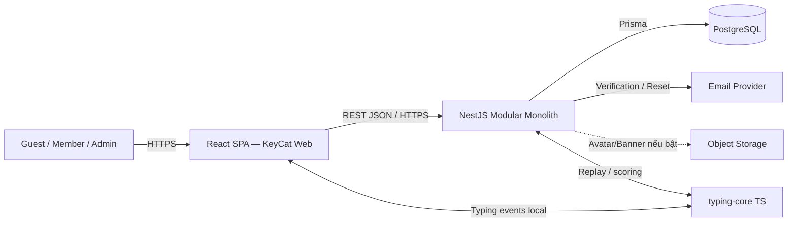
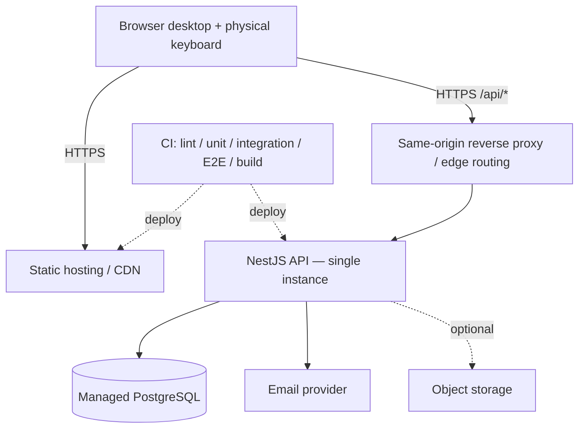
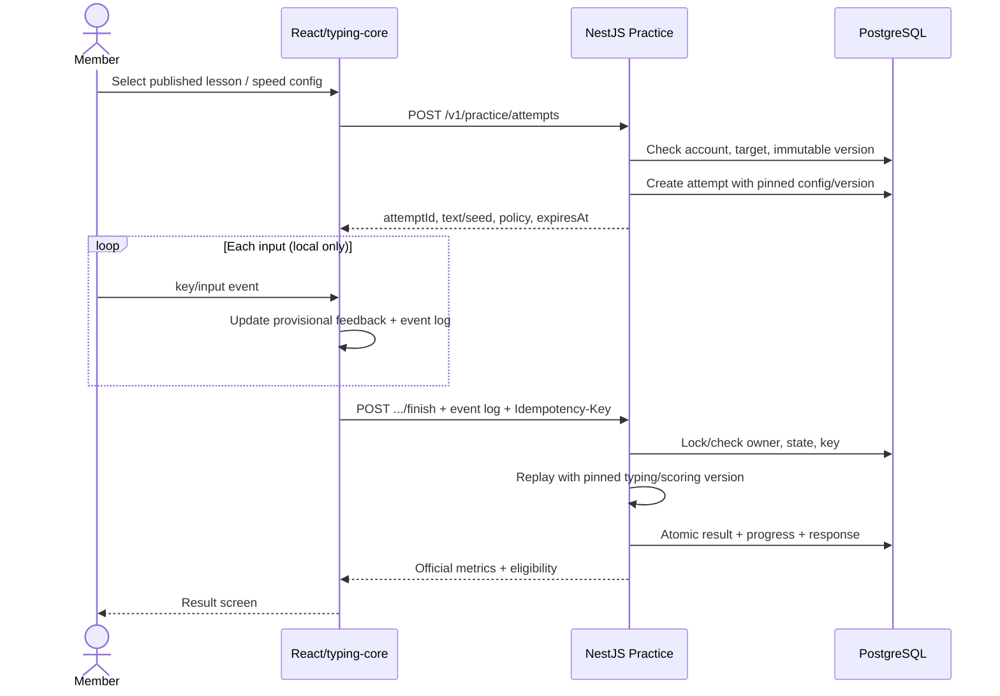

# KeyCat — Software Architecture Document

> **Version:** 1.0 — Technical design draft · **Date:** 15/11/2026  
> **Status:** PROPOSED / chưa phê duyệt triển khai  
> **Sources of truth:** `docs/requirements.md` (PRD 1.0), Project Brief KeyCat, đặc tả v3.0 gốc.  
> **Related:** [`database.md`](./database.md) · [`api-spec.md`](./api-spec.md)  
> **Naming:** KeyCat là tên hiện hành; tên TypePaw trong đặc tả gốc là tên cũ.  
> **Scope:** Thiết kế kiến trúc, không phải mã nguồn hoặc cam kết đã triển khai.

## 1. Executive summary và quy ước quyết định

**Kiến trúc đề xuất:** Modular Monolith; **frontend React SPA** riêng; **backend NestJS duy nhất**; PostgreSQL dùng Prisma; chia sẻ `typing-core` TypeScript thuần giữa browser và backend; REST/JSON qua HTTPS. Không cần microservices, Redis, message broker, Kubernetes hoặc WebSocket cho MVP: phím được xử lý cục bộ, API chỉ cần tạo/kết thúc phiên và đọc dữ liệu.

| Ký hiệu | Ý nghĩa |
|---|---|
| **[LOCKED–PRD]** | Quy tắc nghiệp vụ được nêu như đã chốt trong PRD; không được tự thay đổi ở bước kiến trúc. |
| **[PROPOSED]** | Quyết định thiết kế kỹ thuật do kiến trúc sư đề nghị, cần xem xét trước triển khai. |
| **[PENDING D-xx]** | Quyết định sản phẩm mở trong PRD; không được áp đặt mặc định bằng schema, DTO hay API. |
| **[EXT]** | Ngoài MVP; không tạo endpoint/chức năng hoạt động trước khi được duyệt. |

**Các cam kết nghiệp vụ [LOCKED–PRD]:** guest không được Start; account phải ACTIVE và email verified; mọi Lesson PUBLISHED/ACTIVE được chọn tự do, không unlock; MVP chỉ có Speed Test TIME/WORDS; user template TEXT hoặc GAME_CONTENT chỉ chứa dữ liệu/thuộc whitelist; admin duyệt exact content version trước khi public; 4 bảng rank logic không trộn thành tích; AI/OAuth/game Balloon & Space chưa ở MVP; US-QWERTY vật lý trên desktop là thiết bị chấm điểm; realtime trên client là tạm tính, server replay mới quyết định kết quả chính thức.

**Điều kiện phê duyệt:** D-01, D-04, D-05, A-03 và phần Auth của D-08 đã được duyệt ngày 16/11/2026; xem `decision-log.md`. Các quyết định còn lại vẫn cần phê duyệt trước khi triển khai.

## 2. Technology decision record

| Lớp | Lựa chọn | Trạng thái | Lý do / trade-off |
|---|---|---|---|
| Frontend | React + TypeScript + Vite | [PROPOSED, kế thừa v3.0] | UI gõ realtime, hệ sinh thái lớn, dễ demo; SPA không tối ưu SEO cho tất cả trang nhưng landing có thể prerender về sau nếu cần. |
| Styling | Tailwind CSS + CSS variables/design tokens | [PROPOSED] | Theme/contrast nhất quán, tránh thêm UI framework nặng. |
| Router | React Router | [PROPOSED] | Client-side route, nested layouts và guard UX; guard server vẫn bắt buộc. |
| Remote data | TanStack Query | [PROPOSED] | Cache/invalidation/retry các API đọc; **không** giữ authoritative typing event state. |
| Local UI state | Zustand (hoặc local reducer khi nhỏ) | [PROPOSED] | Lightweight; typing-core quản lý state phiên độc lập, tránh rerender toàn trang trên mỗi keystroke. |
| Charts & i18n | Recharts, react-i18next | [PROPOSED] | Đáp ứng dashboard, VI/EN; UI locale độc lập content locale. |
| Backend | Node.js LTS + NestJS + TypeScript | [PROPOSED, kế thừa v3.0] | Module/DI/DTO/OpenAPI thuận tiện; một tiến trình dễ debug/deploy. |
| Database | PostgreSQL + Prisma | [PROPOSED, kế thừa v3.0] | ACID, FK/CHECK/unique, quan hệ rõ; ràng buộc nâng cao có thể cần raw SQL migration. |
| Shared core | Workspace package `packages/typing-core` | [PROPOSED] | Dùng **cùng một** reducer/scorer thuần TS để feedback client và replay server nhất quán. |
| Package management | pnpm workspaces | [PROPOSED] | Monorepo nhẹ, shared packages tiện; npm workspaces cũng chấp nhận được. |
| Email | SMTP/API email provider | [PROPOSED; provider TBD] | PRD yêu cầu verify/reset; nhà cung cấp thực tế cần chọn khi deploy. |
| Upload | S3-compatible object storage nếu bật avatar/banner | [PROPOSED; optional] | Tránh lưu binary trong DB; có thể bắt đầu chỉ với URL/asset mặc định nếu upload chưa bật theo PRD. |
| Deployment | Static frontend + một API container + managed PostgreSQL | [PROPOSED] | Chi phí và độ vận hành thấp; ví dụ frontend Vercel/Cloudflare Pages, API Render/Fly.io/Railway, Postgres managed; **chưa chọn vendor**. |
| Redis/queue | Không dùng trong MVP | [PROPOSED] | Leaderboard query SQL, gửi mail đồng bộ có xử lý retry giới hạn; bổ sung nếu profiling/throughput chứng minh cần. |

### 2.1. Context diagram



### 2.2. Deployment diagram cơ bản



**[PROPOSED] Prefer `/api` same-origin reverse proxy** để đơn giản hóa cookie, CORS và CSRF surface. Nếu web/API dùng hai origin, phải cấu hình allowlist/CORS credentials và SameSite theo actual domains; không chọn `SameSite=None` trừ khi thực sự cần. Frontend và API deploy độc lập vẫn là **một backend monolith**, không phải microservices.

## 3. C4 container / responsibilities

| Thành phần | Trách nhiệm | Không được làm |
|---|---|---|
| Browser UI | Render, capture input chỉ khi focus trong practice, realtime metrics **tạm tính**, event-log local, gọi API, display server result | Tự xác nhận score/rank cuối, capture phím toàn trang, cho Guest Start |
| `typing-core` | Immutable state, reducer events, metrics/scoring policies theo version, replay deterministic | Phụ thuộc React, DOM, NestJS, DB, gọi API |
| NestJS API | Auth/RBAC/ownership, cung cấp snapshot immutable, validate replay, transaction finalize, publish/moderate, queries | Tin WPM do client gửi, chỉnh sửa kết quả lịch sử |
| PostgreSQL | Data integrity, attempt/result/version/audit persistence, SQL rank queries | Dùng `type+id` polymorphic FK mất ràng buộc nếu có thể tránh |
| Email provider | Gửi link verify/reset | Quyết định role/status |
| Object storage [optional] | Lưu upload đã xác thực | Lưu secrets trong URL công khai |

### 3.1. Read vs write paths

**Read:** React/TanStack Query → `/v1/...` → Controller → Service → Prisma SQL → DTO. GET phân trang/cursor/sort whitelist, cache phía client ngắn hạn; sau mutation invalidate query liên quan.  
**Start:** browser POST target/mode → server check Member/verified/ACTIVE, device policy, PUBLISHED/approved version → create `attempt` pin contentVersion/scoringVersion/expiry → return authoritative snapshot.  
**Typing:** `beforeinput/input`/`keydown` trong vùng practice → `typing-core.reduce` local, không gửi một request/phím.  
**Finish:** event log + `Idempotency-Key` → lock attempt → validate event sequence/timing/length → server replay pinned content+config → transaction persist official result, progress, play events và idempotent response → browser render.  
**Moderation:** Admin review exact `contentVersionId` → atomic update review/published pointer + audit; version draft khác không tự public.

## 4. Backend modules — NestJS modular monolith

Module nghiệp vụ có controller/service/repository boundary; service gọi service khác qua interface/export rõ ràng. **Không chia mỗi bảng thành một service**.

| Module | Trách nhiệm | Phụ thuộc hợp lệ | PRD |
|---|---|---|---|
| `AuthModule` | Register, verify/reset, login/refresh/logout, session rotation, guards | Users, Email, Persistence | FR-02 |
| `UsersModule` | Profile, account status, preferences, owner checks | Persistence, Media(optional) | FR-02/09 |
| `CoursesModule` | Course/Section catalog, browse/filter/pagination | Persistence | FR-03 |
| `LessonsModule` | Lesson metadata, publish lifecycle and immutable content versions | Courses, Content, Persistence | FR-03/10 |
| `ContentModule` | Common `PracticeTarget`/`ContentVersion`, validation & immutable snapshot | Persistence | FR-03/04/07/10 |
| `PracticeModule` | Start/finish/abandon/retry, attempt state machine, replay, official result, idempotency | Content, Typing-core, Persistence, Progress | FR-04 |
| `SpeedTestModule` | TIME/WORDS configs, immutable pool/seed policy, presets validation | Content, Practice, Persistence | FR-05 |
| `ProgressModule` | History, dashboard stats, best lesson progress, weak-key reports | Practice results via read model, Persistence | FR-06 |
| `TemplatesModule` | Owner CRUD/clone, private drafts, TEXT/GAME_CONTENT whitelist, versions and submit | Content, Persistence | FR-07 |
| `ModerationModule` | Review queue, exact-version approve/reject/hide, report resolution | Templates, Audit, Persistence | FR-08/10 |
| `ExploreModule` | Approved public listing, metadata, report intake | Templates, Persistence | FR-08 |
| `LeaderboardsModule` | Four distinct SQL read policies and eligibility/tie-break | Progress, Practice, Templates, Persistence | FR-08 |
| `AdminModule` | Admin endpoints orchestrating user/content/settings/theme/banner | Users, Courses, Lessons, Moderation, Audit | FR-10 |
| `AuditModule` | Append-only sensitive-action log (redacted before/after) | Persistence | FR-10 |
| `EmailModule` | Verify/reset message delivery + provider adapter | Infrastructure | FR-02 |
| `MediaModule` [optional] | Avatar/banner upload authorization, validation, URL lifecycle | Storage provider | FR-09/10 |
| `PersistenceModule` | Prisma client, transactions, health | PostgreSQL | Cross-cutting |

**Module boundaries:** `PracticeModule` owns writes to attempts/results; `ProgressModule` owns best-result projection/queries; `LeaderboardsModule` only reads eligible official data (không tự cộng điểm ngoài transaction). `AdminModule` không trực tiếp sửa dữ liệu bằng endpoint tự phát; chuyển tới domain service. Cross-module cyclic imports là dấu hiệu cần sửa thiết kế.

### 4.1. Shared libraries

- `packages/typing-core`: input normalization policy, event/state reducer, replay, metrics, scorer interfaces, versioned rules. Pure TypeScript, deterministic.
- `packages/contracts`: enum, API types/OpenAPI-generated types **không chứa server secrets**; DTO validation vẫn ở API. Chỉ tạo sau khi API contract được phê duyệt.
- `packages/config` [optional]: tsconfig/ESLint shared; không phải module nghiệp vụ.

## 5. Frontend organization

```text
keycat/
  apps/
    web/
      src/
        app/                  # App bootstrap, router, providers, query client
        pages/                # route composition: landing, auth, dashboard, lessons,
                              # practice, results, speed-test, templates, explore,
                              # leaderboards, profile, admin
        features/
          auth/               # auth UI + hooks + services
          lessons/            # catalog + lesson detail
          practice/           # practice shell, keyboard view, local event adapter
          speed-test/         # presets & mode UI
          progress/           # KPI, charts, history
          templates/          # editor, version view, review submission
          explore/            # listings, filters, reports
          leaderboards/       # board-specific views
          profile/            # settings/security
          admin/              # admin console features
        components/           # shared Button, Input, EmptyState, ErrorState, Modal
        hooks/                # cross-feature hooks only
        services/             # HTTP client, token refresh, HTTP error adapter
        locales/              # vi/en UI dictionaries
        styles/               # tokens, theme
    api/
      src/modules/            # NestJS modules as section 4
      src/common/             # guards, pipes, filters, interceptors
  packages/
    typing-core/
    contracts/                # optional after contract approval
  prisma/                     # Prisma schema + migrations (implementation phase)
  docs/                       # requirements, architecture, database, api-spec
  infra/                      # deploy manifests later
```

**Rules:** component UI only renders; `features/*/services` calls endpoints; hooks coordinate TanStack Query / mutations; typing-specific keyboard event adapter remains feature-local while **scoring rules live in typing-core**. React render only current/visible characters and analytics via throttling/animation frame; do not push each key to global store or server. Route guard is UX only; NestJS guard enforces access.

## 6. Core interaction and consistency

### 6.1. Practice sequence



### 6.2. Cross-cutting invariants

1. Attempt gắn `targetId`, `contentVersionId`, `scoringVersion`, `typingCoreVersion` và configSnapshot **bất biến**; request finish không quyết định những giá trị này.
2. Terminal result là **single-write**: COMPLETED/FAILED/ABANDONED/EXPIRED không trở lại RUNNING. `COMPLETED` khác `passed`.
3. `Idempotency-Key`: cùng attempt/operation/key và cùng payload hash trả response cũ; cùng key khác hash → conflict; key khác trên attempt terminal → một result duy nhất, không cộng lại.
4. `lesson_progress` giữ **best per lesson**; rank Lesson không SUM toàn bộ attempts. Speed TIME/WORDS chỉ so cùng mode, preset, punctuation/numbers và word pool version [APPROVED D-02].
5. `template_reviews` duyệt exact version; content mới giữ draft riêng. Explore chỉ trả approved published version.
6. Không log phím ngoài practice. Replay phát hiện bất thường, **không bảo đảm chống bot tuyệt đối**.
7. Hành động sensitive admin phải có audit; rollback transaction nếu audit không được tạo khi bắt buộc.

### 6.3. Scoring policy cần quyết định

Theo PRD, metric official tối thiểu `effectiveWpm`, `firstTryAccuracy`, `eligibleForRanking`; Lesson còn có `score`, `stars`, `passed`. `typing-core` giữ API rule theo version. **[APPROVED D-01]** score Lesson = round(100 × min(effectiveWpm/goalWpm, 1.5) × firstTryAccuracy/100), tối đa 150; scoringVersion `lesson-v1`. Năm sao dựa trên hoàn thành, accuracy 90/95% và WPM 80/100% goal; passed khi đạt minAccuracy và minPassWpm của bài. `firstTryAccuracy` không reset bằng Backspace; `scoredCorrectCount` dựa trên nội dung cuối được chấm, không trên tổng số insert.

## 7. Security, validation, errors, observability

### 7.1. Authentication / authorization

- **[APPROVED A-03/D-08 Auth]** Access JWT 15 phút trong bộ nhớ web; refresh token opaque, hash lưu server, rotation và revoke; cookie HttpOnly, SameSite=Lax, Secure khi HTTPS. Password dùng Argon2id, 15–128 ký tự; không hardcode secrets.
- Verify/reset email: single-use, hashed token; verify 24 giờ, reset 30 phút, refresh tối đa 7 ngày/idle 24 giờ. Login 10 lần/15 phút; resend/forgot 3 lần/giờ theo email+IP. Upload limits vẫn pending.
- RBAC `MEMBER`, `ADMIN` + account ACTIVE/verified; owner enforcement cho private templates/attempts/results. Suspended user mất quyền Start và refresh session được thu hồi; role chỉ lấy từ DB/token đã xác minh phía server.
- Bảo vệ CSRF nếu cookie được gửi tự động cho endpoint thay đổi trạng thái; với refresh cookie cần origin/CSRF defenses tương ứng deployment. Không cho `Access-Control-Allow-Origin: *` với credentials.

### 7.2. Validation & errors

- NestJS ValidationPipe/DTO whitelist, enum/ID/length/range validation, JSON schema whitelist cho GAME_CONTENT. Cẩn trọng Unicode, escaped output; không render user HTML trực tiếp.
- 400 invalid request; 401 unauthenticated; 403 owner/role forbidden; 404 resource hidden/unknown; 409 state/version/idempotency conflict; 410 archived/unavailable theo policy; 413 event proof quá lớn; 415 bad media MIME; 422 semantic validation; 423 suspended (nếu chính sách dùng); 429 throttled; 5xx unexpected.
- Standard envelope và mã lỗi chi tiết nằm ở `api-spec.md`; phân biệt `INVALID_EVENT_LOG`, `ATTEMPT_EXPIRED`, `TEMPLATE_VERSION_CONFLICT`, `UNSUPPORTED_DEVICE`.
- Không khẳng định backend có thể **chắc chắn** phát hiện bàn phím vật lý; frontend capability gate + server proof policy chỉ hỗ trợ eligibility ở mức khả thi, không thể xác thực thiết bị vật lý tuyệt đối.

### 7.3. Logging / secrets / CORS

- Structured JSON logs: timestamp, level, requestId, route, status, duration, sanitized error. Không log password, raw refresh tokens, full proof/event log, email tokens hoặc request body nhạy cảm.
- `admin_audit_logs` before/after chỉ chứa fields an toàn; audit không thể chỉnh bằng public API.
- Local: `.env` không commit, `.env.example` không có giá trị thật; production env vars/secret manager; keys chỉ ở API runtime. Xoay khóa khi nghi rò rỉ.
- Same-origin deployment ưu tiên; nếu cross-origin, CORS allowlist theo deployment, credentials khi cần, preflight và cookie tested trên domain thực.
- HTTPS, CSP, XSS escaping, upload MIME+size scan/validate, rate limits cho login/verify/reset/templates/reports.
- Truy cập DB từ API qua TLS nếu provider hỗ trợ, least-privilege DB user, backup+restore rehearsal. **[APPROVED D-05]** attempt 30 phút, offline retry cùng key/payload trước expiry, event cap 10.000 hoặc 256 KiB, không lưu raw proof sau replay, partial snapshot tối đa 30 ngày; mất focus không đủ điều kiện rank.

## 8. Testing strategy

| Layer | Công cụ đề xuất | Kiểm thử tối thiểu |
|---|---|---|
| Pure unit | Vitest | Typing reducer, Backspace first-try preservation, Shift/Tab policies, timer/metrics, versioned scorer, Speed seed determinism |
| API unit | Jest/Vitest + Nest testing | Auth guards, owner checks, template whitelist, rank eligibility and mode separation |
| Integration | Test DB PostgreSQL + API | Transactions, FK/CHECK, migrations, finalization idempotency, concurrent admin approve, v1/v2 content pin |
| Contract | OpenAPI schema validation | Request/response error envelope, auth rules, filters/cursor, type changes |
| E2E | Playwright desktop Chromium (+ browser coverage later) | Register/verify(login test stub), Lesson choose free, type/finish/result, Speed, template review, Explore, admin, empty/error states |
| Security | Automated checks + manual | Guest Start 401, Member admin 403, result owner 403, XSS in template, refresh rotation/reuse, rate limit |
| Performance | Browser performance + k6/Artillery (optional) | typing UI smoothness on specified device, GET p95 on defined demo load, SQL EXPLAIN for rankings |

**Mandatory edge scenarios** from PRD: duplicate finish same/different key; offline retry/expiry; A vs B result access; version pin at start; reject script in GAME_CONTENT; Guest no Start; all lessons selectable; self-play no contributor credit; Games board empty; pre-first-try mistakes remain after Backspace. Test thresholds are **[PENDING D-09]**; v3.0 suggests 60 FPS and API read p95 <500ms as targets, not measured facts.

## 9. Deployment, ops và rollback

**[PROPOSED] MVP deployment:** one static web app, one NestJS API container and managed PostgreSQL within same region, external SMTP; object storage only when upload enabled. Enable health/readiness API; graceful shutdown; migrations as controlled release step, **not** automatic destructive migration on every request. Use hosting environment config for `APP_ORIGIN`, `API_ORIGIN`, `DATABASE_URL`, email credentials, JWT keys; choose real values only after vendor/domain approval.

- **CI:** typecheck → lint → unit → integration (ephemeral Postgres) → build web/API → E2E smoke (staging) → deploy. Pin major dependency versions and lockfile.
- **DB changes:** expand → backfill → switch → contract. Migration review for CHECK/composite FKs and Prisma limitations; test on empty+seed and upgraded DB.
- **Backups:** daily backup / regular restore drill proposed [PRD NFR-REL-02], retention interval awaits operations decision. For rollback of app binary, do not assume schema downgrade is safe; design backward-compatible changes.
- **Observability:** error rate, latency, DB connections, failed email, high invalid proof counts, template moderation backlog; logs without PII/secrets.
- **Cost control:** no Redis/queue/K8s, scale API vertically first; add caching/materialized views only if SQL plan and traffic justify.

## 10. Decision register và open questions

### 10.1. Confirm before implementation

| ID | Type | Decision / impact |
|---|---|---|
| A-01 | [APPROVED for foundation, 15/11/2026] | Người yêu cầu đã duyệt kế hoạch nền tảng React/Vite + NestJS/Prisma/PostgreSQL + pnpm workspace; xem `decision-log.md`. |
| A-02 | [PROPOSED] | Confirm static web/API/managed PG provider, same-origin `/api` routing, domain, mail provider. |
| A-03 | [APPROVED 16/11/2026] | Argon2id, access JWT và rotating refresh cookie; xem `decision-log.md`. |
| A-04 | [PROPOSED] | Confirm SQL-first leaderboard, no Redis/queue; object storage only for enabled uploads. |
| A-05 | [PROPOSED] | Decide how to support `GAME_CONTENT` in MVP when only Speed Test engine exists: restrict to *content-only Speed Test configurations* in MVP, future engine keys rejected until engine released. This is a technical interpretation of PRD and requires product confirmation. |
| D-01 | [APPROVED 16/11/2026] | Lesson score/stars/passed và `lesson-v1`; xem §6 và `decision-log.md`. |
| D-02 | [APPROVED 16/11/2026] | TIME 60/120 giây; WORDS 25/50/100 từ. Chỉ ranked khi hoàn tất preset và không mất focus; chỉ so cùng mode, preset, punctuation/numbers và word pool version. |
| D-03 | [PENDING–PRD] | Leaderboard time windows/timezone/tie-break. |
| D-04 | [APPROVED 16/11/2026] | 6 seed lessons CC0-1.0; Template TEXT 20–5000 printable US-QWERTY; xem `decision-log.md`. |
| D-05 | [APPROVED 16/11/2026] | Attempt TTL, retry, event cap, retention và focus policy; xem §7 và `decision-log.md`. |
| D-06 | [PENDING–PRD] | Guest visibility of public metadata/leaderboard. |
| D-07 | [PENDING–PRD] | Keep prior published version while new draft awaits approval or unpublish immediately. |
| D-08 | [APPROVED Auth scope 16/11/2026] | Password, verification/reset/session TTL và auth rate limits; upload constraints còn pending. |
| D-09 | [PENDING–PRD] | Benchmark test device/load and measurable performance thresholds. |
| D-10 | [PENDING–PRD] | All 10 MVP modules vs separately approved smaller first release. |
| D-11 | [PENDING–PRD] | KeyCat public brand/domain/legal availability. |

### 10.2. Explicit non-goals

No Guest practice, lesson prerequisite/unlock, placement tests, AI endpoints, OAuth/MFA, Balloon/Space playable games, mobile/IME-scored input, multi-keyboard layouts, recommendation engine, Redis, job queues, microservices, Kubernetes. No production guarantees until tests/benchmark are run.

## 11. Consistency checklist

- [x] User/roles/10 MVP modules map to PRD FR-01…FR-10.
- [x] Client does realtime display; server validates official result.
- [x] Lesson free selection, Guest cannot Start, Speed only playable game.
- [x] Template exact-version moderation, four separate boards, Games empty.
- [x] Non-approved values flagged D-01…D-11 rather than silently fixed.
- [x] Architecture references entity/constraints in [`database.md`](./database.md) and REST contract in [`api-spec.md`](./api-spec.md).
