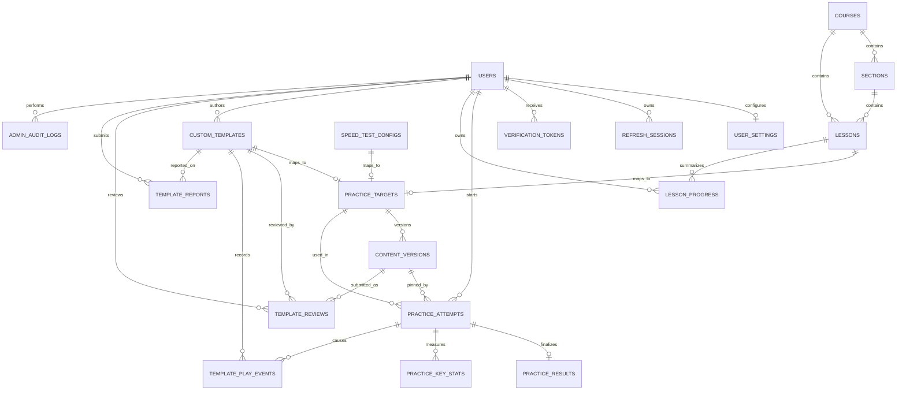

# KeyCat — Database Design

> **Version:** 1.0 / Draft · **Date:** 15/11/2026 · **Database:** PostgreSQL + Prisma [PROPOSED]  
> **Trace:** [`requirements.md`](./requirements.md) FR-02…FR-10, BR-01…BR-12 · [`architecture.md`](./architecture.md) · [`api-spec.md`](./api-spec.md).  
> **Implementation status:** DB-01 identity/curriculum, DB-02 practice/version/progress và DB-03 seed 6 bài đã có migration/seed trên PostgreSQL Docker local. D-01, D-04, D-05 và phần Auth của D-08 đã duyệt; các phần khác vẫn là thiết kế đề xuất.

## 1. Design principles

- **[LOCKED–PRD]** Guest không tạo attempt; lesson published chọn tự do; phiên luyện gắn immutable version; server replay là source of truth; best lesson chỉ tính một lần/lesson; template public phải approve exact version; four boards không trộn metric.
- **[PROPOSED]** UUID PK, `timestamptz` UTC, `created_at`, `updated_at` ở bảng mutable, foreign keys và indexes theo read/write patterns; database constraints là lớp bảo vệ thứ hai sau API validation.
- **[PROPOSED]** Không dùng polymorphic `(source_type,source_id)` nếu có thể thay bằng FK rõ ràng; mô hình `practice_targets` có đúng **một** owner (`lesson_id` hoặc `template_id` hoặc `speed_config_id`).
- **[PROPOSED]** Separate `practice_attempts` (lifecycle), `practice_results` (official terminal result), `lesson_progress` (materialized best), `content_versions` (immutable), `template_reviews` (moderation proof). `score`, `stars`, `passed` không đồng nghĩa nhau.
- **[PROPOSED]** Rankings đọc từ SQL results/progress, không cần Redis hoặc `leaderboard_entries` table trong MVP. Games board sẽ empty/coming soon nếu chưa có game engine.
- **[PENDING]** Không chốt TTL, numeric max lengths, score thresholds, rank timezone, proof retention, upload limits, seed volume. Các cột dữ liệu cần có được định nghĩa nhưng constraints giá trị cụ thể sẽ cấu hình sau khi PO duyệt.

## 2. ERD — core domains

**Cardinality:** `0..1` optional (`user_settings` technically 1:1 after provisioning; nullable during creation), `0..*` repeated. A content version belongs to **one** target and is never updated after publish. An attempt has `0..1` official result; abandoned attempts may instead have partial snapshot. Practice target has exactly one owner (lesson, Speed config or custom template), enforced by SQL CHECK.

## 3. Entity catalog — 24 suggested MVP tables

Below: `PK` primary key; `FK` foreign key; `UQ` unique. SQL types are indicative and **subject to migration review**, not executable DDL. Optional fields explicitly nullable.

### 3.1. Identity / preferences

#### `users` — FR-02, FR-09, FR-10

| Field | Type / constraint | Meaning |
|---|---|---|
| `id` | UUID PK | User ID |
| `email` | varchar UQ NOT NULL, normalized | Login email (case-insensitive uniqueness policy via normalized lower-case or citext) |
| `username` | varchar UQ NOT NULL | Public handle; normalization policy TBD |
| `password_hash` | text NULL | NULL for externally authenticated identities **only when such extension is deployed**; MVP local accounts require hash |
| `display_name` | varchar NULL | Profile |
| `avatar_url` | text NULL | Optional upload |
| `role` | enum/text CHECK `MEMBER`,`ADMIN` | Server-owned RBAC |
| `status` | enum/text CHECK `ACTIVE`,`SUSPENDED`,`DELETED` | Account status |
| `email_verified_at` | timestamptz NULL | Verify gate |
| `timezone` | varchar NULL | Display preference; leaderboard timezone governed separately D-03 |
| `created_at`, `updated_at` | timestamptz NOT NULL | Audit |
| `deleted_at` | timestamptz NULL | Soft-delete/retention policy TBD |

**Note:** No Guest row required. `ADMIN` accounts must be provisioned via trusted administrative workflow, not register payload. Login response is generic when needed to avoid account enumeration.

#### `refresh_sessions` — FR-02

`id UUID PK`, `user_id UUID FK users NOT NULL`, `token_hash text UQ NOT NULL`, `created_at timestamptz`, `expires_at timestamptz`, `revoked_at timestamptz NULL`, `rotated_from_id UUID FK refresh_sessions NULL`, `device_label varchar NULL`, `last_used_at timestamptz NULL`. **UQ token_hash**; index `(user_id, revoked_at, expires_at)`; store **only hash** of refresh token. TTL D-08.

#### `verification_tokens` — FR-02

`id UUID PK`, `user_id UUID FK users NOT NULL`, `purpose CHECK(VERIFY_EMAIL,RESET_PASSWORD)`, `token_hash text UQ`, `expires_at`, `used_at NULL`, `created_at`. Index `(user_id,purpose,expires_at)`; single use. TTL D-08.

#### `user_settings` — FR-01/09

`user_id UUID PK FK users`, `ui_language CHECK(vi,en)`, `theme_key varchar` (`light`,`dark` baseline), `typing_font varchar`, `font_size varchar/int` with allowed range TBD, `show_keyboard boolean`, `show_hands boolean`, `sound_enabled boolean`, `prefs_json jsonb` for strictly whitelisted supplemental preferences, `updated_at`. No executable arbitrary CSS/JS stored as preference.

### 3.2. Curriculum and content

#### `courses` — FR-03/10

`id UUID PK`, `slug varchar UQ`, `title varchar`, `locale varchar`, `status CHECK(DRAFT,PUBLISHED,ARCHIVED)`, `description text NULL`, `created_at`, `updated_at`, `published_at NULL`.

#### `sections` — FR-03/10

`id UUID PK`, `course_id UUID FK courses NOT NULL`, `title varchar`, `order_index int NOT NULL`, `created_at`, `updated_at`. `UNIQUE(course_id,order_index)` and `UNIQUE(id,course_id)` to allow composite FK ensuring lesson belongs to same course as section.

#### `lessons` — FR-03/10

`id UUID PK`, `course_id UUID FK courses NOT NULL`, `section_id UUID NOT NULL`, `course_ordinal int NOT NULL`, `slug varchar`, `title varchar`, `lesson_type CHECK(INTRO,KEY_DRILL,REVIEW,PRACTICE)`, `goal_wpm numeric NULL`, `min_accuracy numeric NULL`, `min_pass_wpm numeric NULL`, `policy_json jsonb` whitelist, `status CHECK(DRAFT,PUBLISHED,ARCHIVED)`, `is_active boolean`, `created_at`, `updated_at`. `UNIQUE(course_id, course_ordinal)`, `(section_id,course_id) FK sections(id,course_id)`. **No prerequisites, unlock state, or placement-test tables.** Threshold values D-01.

#### `speed_test_configs` — FR-05/10

`id UUID PK`, `slug varchar UQ`, `mode CHECK(TIME,WORDS)`, `time_limit_sec int NULL`, `word_target int NULL`, `punctuation_enabled boolean`, `numbers_enabled boolean`, `word_pool_version varchar`, `generator_version varchar`, `status CHECK(DRAFT,PUBLISHED,ARCHIVED)`, `created_at`, `updated_at`. Conditional CHECK: TIME requires time limit (WORDS requires word target), valid preset lists are **D-02**. Immutable effective config must be pinned in content version/attempt snapshot.

#### `practice_targets` — FR-04/05/07

`id UUID PK`, `kind CHECK(LESSON,SPEED_TEST,CUSTOM_TEMPLATE)`, `lesson_id UUID FK lessons NULL`, `speed_config_id UUID FK speed_test_configs NULL`, `custom_template_id UUID FK custom_templates NULL`, `current_content_version_id UUID FK content_versions NULL`, `created_at`, `updated_at`.

**Critical SQL constraint:** `num_nonnulls(lesson_id,speed_config_id,custom_template_id)=1` plus `kind` matching non-null owner; **partial UNIQUE** on each owner FK. `current_content_version_id` must reference a version **belonging to same target** (composite reference `(id,target_id)` in `content_versions`, or transactional validator with explicit DB FK design); nullable temporarily during target creation then set within one transaction. Prisma may require **raw SQL migration** for CHECK/composite/partial constraints; no silent omission.

#### `content_versions` — FR-04/07/10

`id UUID PK`, `target_id UUID FK practice_targets NOT NULL`, `version_no int NOT NULL`, `content_kind CHECK(TEXT,SPEED_CONFIG,GAME_CONTENT,INTRO)`, `content_text text NULL`, `config_json jsonb NOT NULL`, `content_hash varchar NOT NULL`, `source_name varchar NULL`, `source_url text NULL`, `license varchar NULL`, `attribution text NULL`, `created_by UUID FK users NULL`, `created_at`, `published_at NULL`.

`UNIQUE(target_id,version_no)`, `UNIQUE(id,target_id)`; content and config frozen after publish/use. License/source fields required **when using third-party material**. For Speed: store immutable pool/generator config; `seed` for a given attempt lives in `config_snapshot` so both sides reconstruct identical input.

### 3.3. Practice, scoring, progress

#### `practice_attempts` — FR-04/05/06

| Field | Type / constraint | Meaning |
|---|---|---|
| `id` | UUID PK | Unique attempt |
| `user_id` | UUID FK users NOT NULL | Owner |
| `target_id` | UUID FK practice_targets NOT NULL | Lesson/template/Speed target |
| `content_version_id` | UUID FK content_versions NOT NULL | Frozen version pinned on Start |
| `mode` | enum/check `LESSON`,`SPEED_TIME`,`SPEED_WORDS`,`TEMPLATE_TEXT`,`TEMPLATE_GAME_CONTENT` | Domain mode; GAME_CONTENT MVP must map only to supported engine [A-05] |
| `status` | enum/check `READY`,`RUNNING`,`PAUSED`,`COMPLETED`,`FAILED`,`ABANDONED`,`EXPIRED` | Lifecycle |
| `config_snapshot` | jsonb NOT NULL | Immutable rule/config, seed, policies |
| `scoring_version`, `typing_core_version` | varchar NOT NULL | Replay compatibility |
| `started_at`, `first_input_at`, `ended_at`, `expires_at` | timestamptz (nullable by stage) | Server timing |
| `created_at`, `updated_at` | timestamptz | Audit |

**Constraints:** enforce `content_versions(id,target_id)` ownership with composite FK `(content_version_id,target_id)`; status transitions validated in transaction; timeout and timing parameters D-05. Index `(user_id,created_at DESC)` and `(target_id,created_at DESC)`; no duplicate result. `first_input_at` is server-observed / validated against event log; browser monotonic times are untrusted evidence.

#### `practice_results` — FR-04/05/06/08

`attempt_id UUID PK FK practice_attempts`, `effective_wpm numeric NULL`, `first_try_accuracy numeric NULL`, `accuracy_final numeric NULL`, `gross_wpm numeric NULL`, `duration_ms bigint NULL`, `scored_correct_count int NULL`, `score int NULL`, `stars smallint NULL`, `passed boolean NULL`, `verified boolean NOT NULL`, `eligible_for_ranking boolean NOT NULL`, `metric_json jsonb`, `scoring_version varchar`, `finalized_at timestamptz`. Lesson `score/stars/passed`; Speed may leave these NULL. CHECK `0<=accuracy<=100`, stars (if present) 0…5, nonnegative metrics. **Score maximum TBD D-01**; don't introduce `<=100` constraint when v3.0 example allowed 150. Result immutable after finalization except explicit administrative correction workflow **not in MVP**.

#### `practice_key_stats` — FR-04/06

`attempt_id UUID FK practice_attempts`, `key_label varchar`, `attempts int`, `correct_first_try int`, `mistakes int`, `avg_latency_ms numeric NULL`, PRIMARY KEY `(attempt_id,key_label)`. CHECK counts nonnegative; avoid fabricated weak-key stats before reliable evidence.

#### `lesson_progress` — FR-03/06/08

`user_id UUID FK users`, `lesson_id UUID FK lessons`, `best_score int NULL`, `best_stars smallint NULL`, `best_wpm numeric NULL`, `best_attempt_id UUID FK practice_attempts NULL`, `passed_at timestamptz NULL`, `attempts_count int NOT NULL DEFAULT 0`, `updated_at`, **PRIMARY KEY `(user_id,lesson_id)`**. Update only from eligible/verified Lesson outcomes according to policy; `attempts_count` is distinct from best score. For weekly/monthly boards query official historical results **within period**; never use all-time best projection for a time-limited board.

#### `practice_partial_snapshots` — FR-04/06

`attempt_id UUID PK FK practice_attempts`, `cursor_position int`, `active_time_ms bigint`, `partial_metric_json jsonb`, `captured_at timestamptz`. Optional state for ABANDONED/EXPIRED; no ranked result created. Retention D-05.

#### `attempt_finalization_requests` — FR-04

`attempt_id UUID FK practice_attempts`, `operation CHECK(FINISH,ABANDON)`, `idempotency_key varchar`, `request_hash varchar`, `response_json jsonb`, `http_status int`, `created_at`, **PRIMARY KEY `(attempt_id,operation,idempotency_key)`**. Same key+hash returns saved outcome; same key+different hash 409. In one DB transaction with final result/progress/status. `response_json` must exclude secrets.

### 3.4. Templates, community, moderation

#### `custom_templates` — FR-07/08

`id UUID PK`, `creator_id UUID FK users NOT NULL`, `title varchar NOT NULL`, `type CHECK(TEXT,GAME_CONTENT)`, `game_type_key varchar NULL` (whitelisted supported mode), `visibility CHECK(PRIVATE,PUBLIC)`, `status CHECK(DRAFT_PRIVATE,PENDING_REVIEW,APPROVED_PUBLISHED,REJECTED,HIDDEN,ARCHIVED)`, `published_version_id UUID FK content_versions NULL`, `created_at`, `updated_at`, `deleted_at NULL`. Public display **only** if status approved published AND published_version_id points to exact approved version. `game_type_key` in MVP restricted to functioning Speed content variant **[PROPOSED A-05; confirm]**; do not expose future games as runnable.

#### `template_reviews` — FR-07/08/10

`id UUID PK`, `template_id UUID FK custom_templates`, `content_version_id UUID FK content_versions`, `reviewer_id UUID FK users`, `decision CHECK(APPROVED,REJECTED)`, `reason text NULL`, `reviewed_at timestamptz`, `created_at`. One pending submission/decision must reference actual version belonging to template's practice target; optimistic version check / transaction ensures concurrent admin decisions do not conflict. If model needs submission state before decision, use `review_status` on submission (e.g. PENDING) **[PROPOSED]** rather than a fake decision; enforce only one active review per submitted version. `reason` expected on rejection by UX, precise requirement TBD if not in PRD.

#### `template_play_events` — FR-08

`id UUID PK`, `template_id UUID FK custom_templates`, `attempt_id UUID FK practice_attempts`, `user_id UUID FK users`, `event_type CHECK(STARTED,COMPLETED)`, `created_at`, `UNIQUE(attempt_id,event_type)`. STARTED only from valid attempt Start; COMPLETED only after verified eligible finish. Contributors = `COUNT(DISTINCT user_id)` by author with self-play excluded; never increase count on GET detail.

#### `template_reports` — FR-08/10

`id UUID PK`, `template_id UUID FK custom_templates`, `reporter_id UUID FK users`, `reason_code varchar`, `description text NULL`, `status CHECK(OPEN,REVIEWED,CLOSED)`, `reviewed_by UUID FK users NULL`, `created_at`, `updated_at`. Rate-limit report submissions; do not grant automatic takedown solely from report count.

### 3.5. Admin, configuration, audit

#### `admin_audit_logs` — FR-10

`id UUID PK`, `actor_id UUID FK users`, `action varchar`, `target_type varchar`, `target_id UUID NULL`, `before_json jsonb NULL`, `after_json jsonb NULL`, `request_id varchar NULL`, `created_at timestamptz NOT NULL`. Append-only by application policy + restrict DB permissions; redact credentials and private proof. Index `(actor_id,created_at DESC)`, `(target_type,target_id,created_at DESC)`.

#### `themes` — FR-01/09/10

`id UUID PK`, `theme_key varchar UQ`, `name varchar`, `tokens_json jsonb` (whitelist), `is_active boolean`, `created_at`, `updated_at`. Light/Dark defaults in MVP; no unsafe arbitrary style/code injection.

#### `banners` — FR-01/10

`id UUID PK`, `title varchar`, `image_url text`, `target_url text NULL`, `status CHECK(DRAFT,PUBLISHED,ARCHIVED)`, `published_from timestamptz NULL`, `published_to timestamptz NULL`, `created_at`, `updated_at`. URL schema/domain validation; optional asset upload.

#### `site_settings` — FR-10

`key varchar PK`, `value_json jsonb`, `updated_by UUID FK users`, `updated_at`. **Only server-approved keys** mutable; don't turn this into dynamic configuration for authorization/scoring without versioning.

### 3.6. What is intentionally NOT a table in MVP

No `lesson_prerequisites`, `lesson_unlocks`, `placement_assessments`, Guest practice claims, OAuth identities, AI jobs, general game engine/game versions, Redis snapshots or combined `leaderboard_entries`. Game-specific data and queue/outbox may be introduced only with approved extensions; the logical `GAMES` board is an empty-state/read endpoint for now.

## 4. Relationship / integrity rules

| Relationship | Cardinality | Constraint |
|---|---|---|
| User → Settings | 1 : 0..1 (eventually 1) | `user_settings.user_id PK/FK` |
| Course → Sections / Lessons | 1 : many | FKs, section-course composite constraint |
| Lesson / Template / SpeedConfig → PracticeTarget | each 1 : 0..1 | partial UNIQUE per owner; exactly-one owner CHECK |
| PracticeTarget → ContentVersions | 1 : many | `UNIQUE(target_id,version_no)` |
| Attempt → Pinned ContentVersion | many : 1 | composite `(content_version_id,target_id)` owner match |
| Attempt → Result | 1 : 0..1 | `practice_results.attempt_id PK/FK` |
| User+Lesson → Progress | many to many via projection | composite PK; best only |
| Template → Reviews | 1 : many | exact-version approval and mutable draft separate |
| Attempt → PlayEvents | 1 : 0..2 | UNIQUE `(attempt_id,event_type)` |
| User → Audit | 1 : many | append-only + staff permissions |

**Circular-reference bootstrap:** `practice_targets.current_content_version_id` points to `content_versions.id` while version references target. Create target first with nullable pointer, create version, set pointer and publish state **in one transaction**; enforce pointer is among same target's versions. A unique FK on `(id,target_id)` and a compound FK/pointer check may require SQL migration with Prisma. Ensure transactional rollback when pointer cannot be set.

## 5. Index plan and query patterns

| Query | Index / strategy | Motivation |
|---|---|---|
| Login | `users(email)` UQ normalized, `users(username)` UQ | Exact lookup |
| Session refresh | `refresh_sessions(token_hash)` UQ, `(user_id,revoked_at,expires_at)` | Rotation/revoke |
| Lessons list | `lessons(course_id,course_ordinal)`, `sections(course_id,order_index)` | Stable catalog paging |
| Current content | `content_versions(target_id,version_no)` UQ | Version pin lookup |
| User recent attempts | `practice_attempts(user_id,created_at DESC,id DESC)` | Keyset history |
| Results for ranking | partial or composite on `(eligible_for_ranking,effective_wpm DESC)` plus join/mode/config filters | Speed board; verify with EXPLAIN |
| Lesson best | `lesson_progress(user_id,lesson_id)` PK + read index by `lesson_id` if board demands | Best-per-lesson |
| Public Explore | `(status,visibility,created_at DESC,id DESC)` on templates | Approved catalog pagination |
| Review queue | `custom_templates(status,updated_at)`, `template_reviews(template_id,created_at)` | Pending review |
| Contributor metrics | `template_play_events(template_id,event_type,user_id)` | Distinct completed players |
| Admin audit | `(actor_id,created_at DESC)`, `(target_type,target_id,created_at DESC)` | Investigate actions |

**Caution:** exact index selection follows **EXPLAIN ANALYZE on representative seeded data**, not blanket creation of every proposed index. SQL/materialized views only when SQL performance degrades; Redis not planned in MVP. Cursor pagination uses stable `(created_at,id)` or `(course_ordinal,id)` ordering; beware deletions and ties.

## 6. Transaction boundaries, concurrency, deletion

1. **Start attempt:** ensure user status/verified, target visibility/version; persist a single attempt with immutable config before responding. Content update after Start must not change this attempt.
2. **Finish attempt:** lock attempt row or use compare-and-set state; validate terminal/TTL/proof; replay; insert exactly one result; update best projection and `template_play_events`; store idempotency response; commit atomically. Concurrent requests on same attempt must not create two results.
3. **Review template:** lock template submission/version; verify pending and content ownership, admin authorization; insert decision + set publishedVersion/status + audit in same transaction; stale admin decision conflict (409).
4. **Publish lesson / speed config:** validate immutable version, adjust current pointer in transaction; historical attempts do not change.
5. **Suspend user:** update status + revoke refresh sessions + audit within transaction. API start and refresh revalidate account status.
6. **Deletion:** account removal, related public templates/attribution, result anonymization and proof/event retention are **[PENDING D-05 and product/legal policy]**. Avoid unreviewed CASCADE deletion that destroys audit/integrity; choose soft delete/anonymization only after retention decision.

## 7. Migration strategy

- Use Prisma migrations for ordinary tables/indexes and **reviewed SQL migrations** for `CHECK`, partial indexes, composite FK and immutable-result protections unsupported in Prisma DSL.
- Naming: timestamped incremental migrations; never edit an applied production migration; create new corrective migration.
- Workflow: design review → migration dry run on clean DB → migration test on previous schema/seed → backup/snapshot → staged rollout → `prisma migrate deploy` at release → smoke tests.
- **Expand–migrate–contract** for breaking changes: add nullable/backward-compatible field → backfill → deploy code reading it → enforce NOT NULL/drop old field in later release.
- Content/scoring changes require new **content version/scoringVersion** rather than mutating historical rows or silently recomputing official results.
- Seed: deterministic small licensed content set for Home/Top/Bottom Rows, Shift, Numbers, Symbols; original concept mentioned ~685 lessons but **not verified/required to ship**. Volume of seed is D-04.
- No production downgrade assumption; rollback app using backward-compatible schema and restore DB only under operational incident procedure.

## 8. Data quality & privacy

- Query raw proof/event payload **is not required as a permanent table** by current PRD; transient finish payload + optional bounded retention storage only after D-05. This design stores `practice_attempts` and official aggregated result; do not create global keyboard logging.
- Email, token hashes, request metadata and user content are PII/security-sensitive; enforce owner access and admin access policy, encrypted transport, least-privilege credentials, backup access.
- Store only needed audit before/after fields and sanitize user-provided titles/quotes; permissions are always checked on API, not inferred from client or exposed columns.
- Use UTC `timestamptz` to store events; local timezone for user display is independent from leaderboard period policy D-03.

## 9. Decisions requiring approval

| Ref | Unresolved | DB impact |
|---|---|---|
| D-01 | Score/pass/stars final rules | Column ranges, scorer version and leaderboard logic |
| D-02 [APPROVED 16/11/2026] | TIME 60/120 giây, WORDS 25/50/100 từ; chỉ so cùng mode, preset, punctuation/numbers và word pool version; không ranked khi mất focus | Config validation, ranking partitions, seed details |
| D-03 | Rank windows/timezone/tie breaks | Aggregate SQL, time indexes |
| D-04 | Content lengths/licensing/initial lessons | Validation, varchar bounds, seed/import |
| D-05 | Attempt timeout/log cap/retention/focus | `expires_at`, snapshot/proof storage, cleanup policy |
| D-06 | Guest public visibility | Public read policy, no DB permission for guest Start |
| D-07 | What happens to public v1 when draft v2 exists | Published pointer/visibility transitions |
| D-08 | Auth TTL/quotas/upload limits | Expiry/size validation, rate-limit storage selection |
| D-09 | Performance targets | Index/SQL verification under load |
| D-10 | MVP release scope | Migration release sequencing |
| D-11 | Brand/domain | No structural DB change |
| A-05 | GAME_CONTENT restricted to currently supported Speed content | Allowed game_type_key/content-kind constraint |

## 10. Acceptance and consistency checks for schema review

- [ ] All FKs, one-owner CHECK and same-target version references enforceable in real PostgreSQL migrations.
- [ ] No Guest attempt; every scored result belongs to a verified-at-start account and a pinned content/scoring version.
- [ ] Concurrent finish same attempt cannot produce two `practice_results` or duplicate `lesson_progress`/play events.
- [ ] Content publish v2 leaves historical attempt v1 reproducible.
- [ ] Pending/rejected/draft content never accidentally appears in public Explore queries.
- [ ] `GAMES` rankings never reuse Speed Test rows.
- [ ] Best-per-lesson query cannot be farmed by low-score replay; contributor count filters self-play/views.
- [ ] Restore process and privacy/retention policies approved before production launch.
