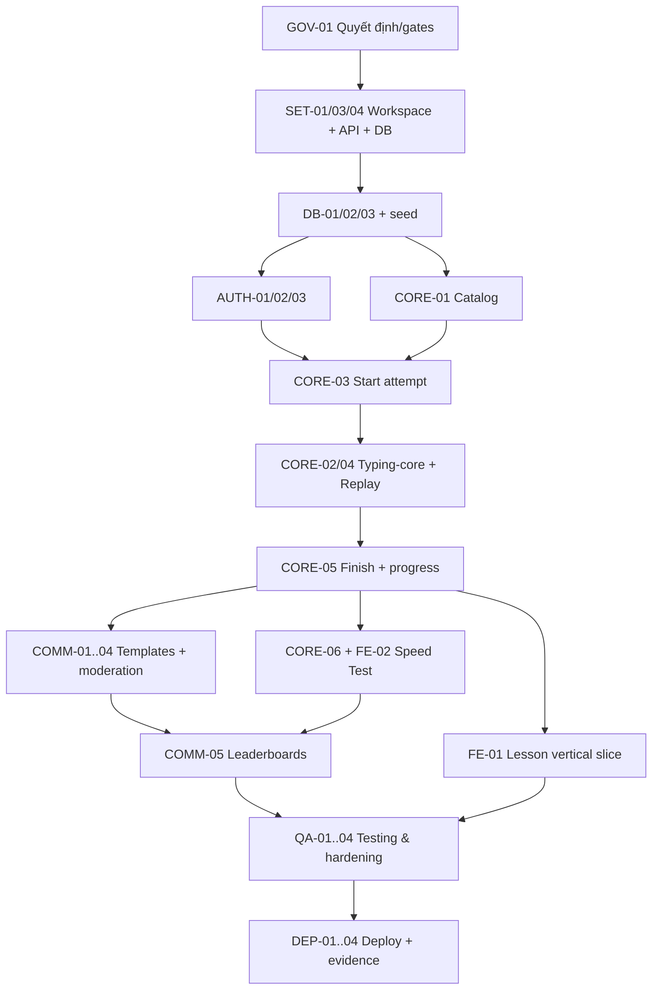

# KeyCat — 4-week Development Roadmap

> **Phiên bản:** 1.0 · **Ngày:** 15/11/2026 · **Tình trạng:** kế hoạch đề xuất, chưa có code thực thi.
> **Căn cứ:** [PRD](./requirements.md), [Architecture](./architecture.md), [Database](./database.md), [API](./api-spec.md), [Task backlog](./tasks.md).
> **Mốc lịch:** 4 tuần kể từ ngày khởi động được PO duyệt (không gán ngày cố định). 3 tuần là kịch bản tăng rủi ro, không mặc nhiên là hạn hoàn thành.

## 1. Mục tiêu và giả định năng lực

Tập trung đạt **walking skeleton** (web ↔ API ↔ DB) trong tuần 1, **vertical slice login → lesson → typing → official result** trong tuần 2, hoàn thành tính năng cộng đồng/quản trị trong tuần 3–4, và có release được kiểm thử, triển khai, ghi README vào cuối tuần 4.

**Ràng buộc đã chốt từ PRD:** Guest không Start; email verified + ACTIVE mới Start; lesson chọn tự do; chỉ Speed Test playable trong MVP; Template public duyệt đúng version; leaderboard tách 4 board với Games empty; không AI/OAuth/advanced games; desktop physical US QWERTY.

**Không được nhầm “demo chạy sớm” với “MVP v3.0 hoàn chỉnh”.** Cả 10 module M01–M10 (kể cả các mục Should Have) vẫn trong release mục tiêu, trừ khi PO ra quyết định D-10 giảm scope.

Backlog gồm **38 task** (3 S, 19 M, 16 L). Đây là lượng việc **rất tham vọng** cho một developer trong 4 tuần, đặc biệt khi có 24 bảng đề xuất, server replay, moderation và quản trị. Ước lượng S/M/L chỉ hỗ trợ phân tích tải; không bảo đảm hoàn thành. Có thể cần giảm scope được duyệt hoặc kéo dài lịch nếu effort thực tế vượt capacity.

### Gate trước khi code

| Gate | Phải quyết định | Task bị ảnh hưởng |
|---|---|---|
| G0 — stack/infrastructure | A-01 stack/workspace; A-02 topology, hosting/email | SET-01, DEP-01 và mọi triển khai sau |
| G1 — scoring/session/content | D-01, D-04, D-05, D-08 | DB-02/03, AUTH-01/02, CORE-02/04/05 |
| G2 — Speed/ranking | D-02, D-03 | CORE-06, COMM-05, FE-02 |
| G3 — community permissions | D-06, D-07, A-05 | COMM-01/03/04, FE-04 |
| G4 — quality/release | D-09 benchmark, D-10 release scope, D-11 brand; A-03 auth, A-04 SQL-first | QA-04, DEP-02, DEP-04 |

Không có phê duyệt → đánh dấu **BLOCKED**, không thay thế bằng default tự chọn. Có thể triển khai skeleton/khung UI độc lập trong khi chờ PO.

## 2. Kế hoạch theo tuần

### Tuần 1 — Nền tảng chạy được và luồng đầu tiên

**Outcome:** Web và API cùng hoạt động, PostgreSQL migrate được, seed lesson nhỏ, member đăng ký/xác minh/login được, GET catalog từ DB.

**Definition of demo/increment:** Demo: truy cập landing → đăng ký và xác minh (sandbox mail/provider được duyệt) → đăng nhập → đọc danh sách bài thật từ PostgreSQL. Chưa công bố typing score chính thức.

| Task ID | Nội dung | Ưu tiên | Size |
|---|---|---|:---:|
| [GOV-01](./tasks.md#gov-01) | Chốt quyết định chặn triển khai | P0 | M |
| [SET-01](./tasks.md#set-01) | Khởi tạo workspace và công cụ chất lượng | P0 | S |
| [SET-02](./tasks.md#set-02) | App shell và thiết kế điều hướng | P0 | M |
| [SET-03](./tasks.md#set-03) | API skeleton, config và health endpoint | P0 | S |
| [SET-04](./tasks.md#set-04) | CI cơ bản + Docker Compose local | P0 | M |
| [DB-01](./tasks.md#db-01) | Prisma schema cho identity và curriculum | P0 | M |
| [DB-02](./tasks.md#db-02) | Schema content version, attempt và progress | P0 | L |
| [DB-03](./tasks.md#db-03) | Seed học liệu nhỏ có bản quyền hợp lệ | P0 | M |
| [AUTH-01](./tasks.md#auth-01) | Đăng ký + email verification | P0 | L |
| [AUTH-02](./tasks.md#auth-02) | Login, refresh rotation và logout | P0 | L |
| [CORE-01](./tasks.md#core-01) | Catalog Course/Section/Lesson API | P0 | M |

**Workload tương đối:** 11 task; 2 S, 6 M, 3 L.

### Tuần 2 — Core vertical slice có chấm điểm chính thức

**Outcome:** typing-core + start/finish/replay/version/idempotency, Speed Test backend, history/stats; web practice kết nối API.

**Definition of demo/increment:** Demo: login → chọn Lesson bất kỳ → gõ realtime → nhận kết quả verified → refresh xem history → retry không cộng trùng.

| Task ID | Nội dung | Ưu tiên | Size |
|---|---|---|:---:|
| [AUTH-03](./tasks.md#auth-03) | Guards, RBAC và ownership | P0 | M |
| [AUTH-04](./tasks.md#auth-04) | Forgot/reset/change password | P0 | M |
| [CORE-02](./tasks.md#core-02) | Typing-core reducer và event normalization | P0 | L |
| [CORE-03](./tasks.md#core-03) | Start attempt + immutable snapshot | P0 | M |
| [CORE-04](./tasks.md#core-04) | Server replay, metrics, scoring | P0 | L |
| [CORE-05](./tasks.md#core-05) | Finish/abandon idempotent + progress | P0 | L |
| [CORE-06](./tasks.md#core-06) | Speed Test TIME/WORDS API và preset | P0 | L |
| [CORE-07](./tasks.md#core-07) | Dashboard, history và result reads | P0 | M |
| [FE-01](./tasks.md#fe-01) | Vertical slice Lesson hoàn chỉnh | P0 | L |

**Workload tương đối:** 9 task; 0 S, 4 M, 5 L.

### Tuần 3 — Hoàn thiện tính năng người dùng và cộng đồng

**Outcome:** Speed Test UI, dashboard/profile, admin quản trị giáo trình, Templates private + review + Explore/report.

**Definition of demo/increment:** Demo: TIME/WORDS và history; owner tạo template, Admin duyệt version, người khác thấy trong Explore và thực hành.

| Task ID | Nội dung | Ưu tiên | Size |
|---|---|---|:---:|
| [FE-02](./tasks.md#fe-02) | Speed Test UI + settings cơ bản | P0 | M |
| [FE-03](./tasks.md#fe-03) | Dashboard/history/profile UI | P0 | M |
| [COMM-01](./tasks.md#comm-01) | Schema và API Templates private | P1 | L |
| [COMM-02](./tasks.md#comm-02) | Template UI và submit review | P1 | M |
| [COMM-03](./tasks.md#comm-03) | Admin moderation workflow | P1 | L |
| [COMM-04](./tasks.md#comm-04) | Explore, report và template play counting | P1 | M |
| [ADMIN-01](./tasks.md#admin-01) | Admin quản lý giáo trình và Speed config | P0 | L |

**Workload tương đối:** 7 task; 0 S, 4 M, 3 L.

### Tuần 4 — Xếp hạng, vận hành, hardening, triển khai

**Outcome:** 4 board SQL (Games empty), quản trị user/theme/banner/audit, UI polish, regression, E2E, security, perf probe, staging, public deploy, README và release audit.

**Definition of demo/increment:** Demo: 3 vai trò, 4 board, admin workflow; staging/public URL HTTPS; test/README/evidence đầy đủ, không blocker mở.

| Task ID | Nội dung | Ưu tiên | Size |
|---|---|---|:---:|
| [COMM-05](./tasks.md#comm-05) | 4 leaderboard chính sách SQL riêng | P1 | L |
| [ADMIN-02](./tasks.md#admin-02) | Admin users, audit, site/theme/banner | P1 | L |
| [FE-04](./tasks.md#fe-04) | Explore, ranking và admin integration polish | P1 | M |
| [QA-01](./tasks.md#qa-01) | Unit + integration regression toàn bộ core | P0 | L |
| [QA-02](./tasks.md#qa-02) | Security & privacy hardening | P0 | M |
| [QA-03](./tasks.md#qa-03) | E2E full journeys và UX states | P0 | L |
| [QA-04](./tasks.md#qa-04) | Performance probe, bug bash và freeze | P0 | M |
| [DEP-01](./tasks.md#dep-01) | Triển khai staging và migration an toàn | P0 | L |
| [DEP-02](./tasks.md#dep-02) | Production release/portfolio demo | P0 | M |
| [DEP-03](./tasks.md#dep-03) | README, portfolio case study và bằng chứng | P0 | M |
| [DEP-04](./tasks.md#dep-04) | Release audit và backlog còn lại | P0 | S |

**Workload tương đối:** 11 task; 1 S, 5 M, 5 L.

## 3. Critical path và phụ thuộc

**Đường găng bắt buộc:** quyết định scoring/session → core model/version → auth/owner → attempt → replay → finish/idempotency → E2E → deploy. Không đưa chấm điểm chính thức lên production nếu chưa pass chống farm, replay/version và retry double-finish.

### Công việc có thể làm song song (một developer: xen kẽ, không phải đồng thời vật lý)

- Sau SET-01: **SET-02 App shell** và **SET-03 API skeleton** độc lập tương đối; DB-01 triển khai sau API bootstrap.
- Sau DB-01: **Auth** và catalog read UI skeleton có thể làm xen kẽ; chỉ nối thật sau AUTH-02 và DB-03.
- Khi CORE-02 reducer đang phát triển, **FE-01 presentation skeleton** có thể dựng với contract mock có nhãn tạm; tích hợp thật và claim AC chỉ sau CORE-03/05.
- Sau CORE-05: dashboard queries và Speed API phát triển tách phần; templates UI dựng độc lập sau COMM-01.
- Tuần 4: viết README/test cases có thể bắt đầu sớm; **DEP-02** chỉ sau deploy staging và QA Go/No-Go.

## 4. Thực thi theo vertical slices

| Slice | End-to-end result | Gồm task | Cửa nghiệm thu |
|---|---|---|---|
| S0 | React page gọi API + DB health | SET-01…04, DB-01 | Fresh clone chạy được |
| S1 | Guest đăng ký/verify/login và xem Lesson từ DB | AUTH-01/02, DB-03, CORE-01 | E2E auth/catalog |
| S2 | Member gõ Lesson và có official result | CORE-02…05, FE-01, CORE-07 | Double-finish và version test pass |
| S3 | Member Speed Test TIME/WORDS + dashboard | CORE-06, FE-02/03 | Test 2 modes, no mixed score |
| S4 | Template private → Admin approve → Explore | COMM-01…04, ADMIN-01 | Chỉ approved version public |
| S5 | Ranking + Admin vận hành + deployment | COMM-05, ADMIN-02, FE-04, QA, DEP | Full MVP checklist + HTTPS |

## 5. Milestone/Go-No-Go và buffer

| Checkpoint | Tiêu chí Go | Nếu No-Go |
|---|---|---|
| Cuối tuần 1 | Monorepo/DB/health + auth/catalog theo gates đã duyệt | Hoãn tích hợp scoring, sửa setup hoặc xin quyết định |
| Cuối tuần 2 | Một Lesson gõ→finish official→result/history với idempotency test | Chưa chuyển sang community; ưu tiên fix core |
| Cuối tuần 3 | Speed/UI + Templates/Moderation/Explore và admin lesson hoạt động | Chuyển việc tồn sang backlog; báo PO tác động tới D-10 |
| Cuối tuần 4 | E2E/core/security/deploy pass, không critical/high bug, docs/README trung thực | NO-GO full MVP; demo bản nội bộ có nhãn chưa đủ scope hoặc xin gia hạn/đổi phạm vi |

**Dự phòng:** giữ **tối thiểu 20–25% năng lực tuần 4** cho bug fixes, integration surprise và deployment, không lên kế hoạch feature mới vào slot này. Với tải task hiện tại, cần review capacity sau mỗi tuần và chủ động đưa việc thấp ưu tiên về sau *chỉ khi PO phê duyệt scope change*.

## 6. Nhịp làm việc cho solo developer + Codex

1. **Plan (mỗi đầu tuần):** kiểm tra decision gates, chọn 3–5 task quan trọng nhất theo dependency; ước lượng lại bằng dữ liệu thực tế.
2. **Daily (10 phút):** ghi Yesterday/Today/Blockers trên issue hoặc `docs/tasks.md`; mỗi lần chỉ có 1 task chính `IN_PROGRESS`.
3. **Implementation:** giao duy nhất một task ID cho Codex theo mẫu trong `tasks.md`; review diff, không chấp nhận tự thêm scope.
4. **Verification:** chạy test tại task boundary; chụp bằng chứng API/GUI; merge sau lint/typecheck/tests.
5. **Weekly review:** demo increment có thể chạy, cập nhật hoàn thành vs dự báo, rà decision register, note rủi ro.
6. **Release:** staging first → smoke/E2E/security → Go/No-Go → production → smoke lại → README/screenshots.

## 7. Definition of Done (release-level)

- Tất cả **Must + Should thuộc MVP v3** hoàn tất và nghiệm thu hoặc có quyết định D-10 phê duyệt release rút gọn.
- Core: server authoritative scoring từ event proof, version pin, một result/attempt, best-per-lesson, chống farm/retry double count.
- Security: auth/verify/ACTIVE/owner/admin, cookie/CORS/CSRF, rate limits theo policy, logs redacted, no embedded secrets.
- Database: migration/constraints/indexes apply clean; rollback/backup strategy documented.
- UX: loading/error/empty states, VI/EN Light/Dark, desktop physical keyboard, mobile view only.
- Tests: unit/integration/E2E theo journeys, staging smoke, benchmark có điều kiện đo; không tuyên bố mục tiêu hiệu năng chưa benchmark.
- Deploy: HTTPS, health, SMTP, environment setup và rollback path; không public credentials.
- Portfolio: README trung thực, architecture/DB/API docs, screenshots/demo URL, known limitations và release notes.

## 8. Rủi ro và phản ứng

| Rủi ro | Mức | Phản ứng |
|---|---|---|
| Một developer + 10 module + 24 bảng trong 4 tuần | Cao | Review capacity weekly; freeze scope; xin phê duyệt D-10 nếu cần release rút gọn; không tự cắt Should |
| Chính sách D-01/02/05 chưa duyệt | Cao | Ưu tiên GOV-01; không hardcode default scoring/TTL |
| Replay/event keyboard khó test, bot proof không thể xác thực tuyệt đối | Cao | Golden fixtures, server timing checks, stated limitation; không quảng cáo anti-cheat tuyệt đối |
| Review version, optimistic lock, rank sai dữ liệu | Cao | Transaction + concurrent tests + verified SQL fixtures |
| Gửi email/cookie hosting cross-site | Trung bình | Staging email/browser thử sớm, ưu tiên same-origin proxy |
| Thiếu học liệu có license | Trung bình | Duyệt word pool nhỏ để seed; không sao chép 685 bài |
| Tốn thời gian thiết kế đẹp và mascot | Trung bình | Giữ UI minimal, Could chỉ sau Go/No-Go |

## 9. Ngoài phạm vi

AI, OAuth/MFA, Balloon/Space playable, Guest Practice, lesson unlock/placement, IME/mobile scored typing, Redis/queue/microservices/K8s; không tự sinh thêm tính năng hoặc policy chưa được duyệt.
